# Isolation Levels

> **Definition:** when two transactions run **at the same time**, the isolation level decides **what each one sees of the other's changes**. A higher level means fewer surprises, but more errors you must retry.

| Part | Contents |
|---|---|
| [Part 1 — The 5 problems](#part-1--the-5-problems) | what goes wrong when transactions run concurrently |
| [Part 2 — The 4 levels](#part-2--the-4-levels) | how each level behaves, and which problems it prevents |

## Setup (for every example)

Open **two terminals**: `docker compose exec pg psql -U app -d shop` in each. Call them **T1** and **T2**.

```sql
CREATE TABLE accounts (id int PRIMARY KEY, owner text NOT NULL, balance int NOT NULL);
INSERT INTO accounts VALUES (1, 'Ali', 1000), (2, 'Sara', 500);

CREATE TABLE doctors (name text PRIMARY KEY, on_call bool NOT NULL);
INSERT INTO doctors VALUES ('Omar', true), ('Lina', true);
```

Reset before each example:
```sql
UPDATE accounts SET balance = 1000 WHERE id = 1; DELETE FROM accounts WHERE id > 2;
UPDATE doctors SET on_call = true;
```

All outputs in this file come from running both sessions concurrently on PostgreSQL 17.

---

# Part 1 — The 5 problems

> **Definition:** a concurrency **problem** (anomaly) is a wrong or surprising result that appears only when two transactions run **at the same time**. Run them one after another and it disappears. Isolation levels exist to prevent these problems.

| # | Problem | One line |
|---|---|---|
| 1 | [Dirty read](#1-dirty-read) | you read a change that was **never committed** |
| 2 | [Non-repeatable read](#2-non-repeatable-read) | the **same row**, read twice, gives **two values** |
| 3 | [Phantom read](#3-phantom-read) | the **same query**, run twice, returns a **different set of rows** |
| 4 | [Lost update](#4-lost-update) | two writers start from the same value, one change **disappears** |
| 5 | [Write skew](#5-write-skew) | two writers change **different rows**, together they **break a rule** |

## 1. Dirty read

**Definition:** reading data that another transaction changed but **has not committed**. It may still roll back, so you saw a value that never existed.

**Example:** a transfer sets Ali's balance to 0, then fails and rolls back. A balance screen reads in the middle.

| Step | T1 (balance screen) | T2 (transfer) | Ali's real balance |
|---|---|---|---|
| 1 | | `BEGIN`, set balance = **0** (no commit) | 1000 |
| 2 | reads balance → **?** | | 1000 |
| 3 | | `ROLLBACK` | 1000 |

A database that allows dirty reads returns **0** at step 2: a number that never existed. Ali sees "no money" and the app may block a payment.

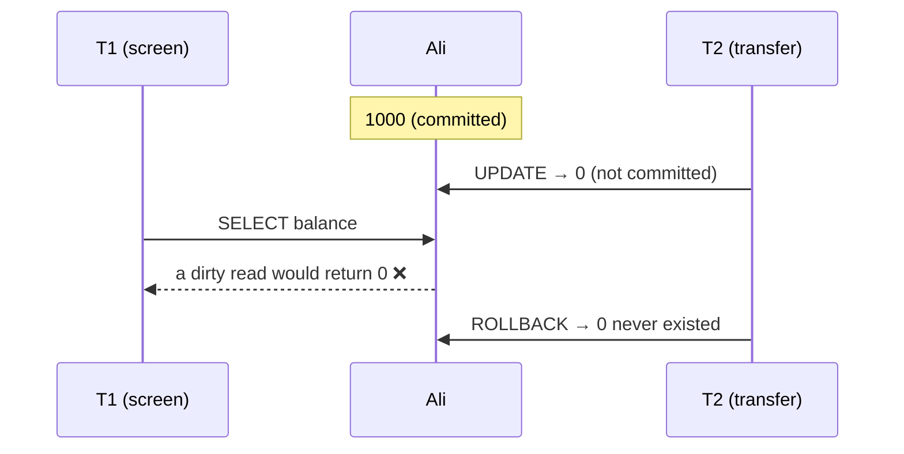

**SQL:**
```sql
-- T2
BEGIN;
UPDATE accounts SET balance = 0 WHERE id = 1;

-- T1
BEGIN ISOLATION LEVEL READ UNCOMMITTED;
SELECT balance FROM accounts WHERE id = 1;
--  1000          ← PostgreSQL never shows uncommitted data, even at this level
COMMIT;

-- T2
ROLLBACK;
```

| Level | T1 reads (measured) |
|---|---|
| Read Uncommitted | 1000 ✅ |
| Read Committed | 1000 ✅ |
| Repeatable Read | 1000 ✅ |
| Serializable | 1000 ✅ |

## 2. Non-repeatable read

**Definition:** a transaction reads the **same row** twice and gets **different values**, because another transaction committed a change in between.

**Example:** a report prints Ali's balance at the top and again at the bottom.

| Step | T1 (report) | T2 | T1 sees |
|---|---|---|---|
| 1 | read Ali's balance | | 1000 |
| 2 | | set balance = 900 + `COMMIT` | |
| 3 | read Ali's balance again | | **900** ⚠️ |

The top of the report says 1000, the bottom says 900, and the total doesn't add up.

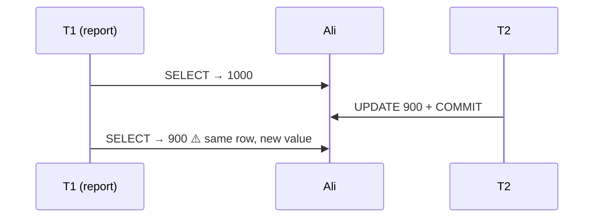

**SQL:**
```sql
-- T1
BEGIN ISOLATION LEVEL READ COMMITTED;
SELECT balance FROM accounts WHERE id = 1;   -- 1000

-- T2
UPDATE accounts SET balance = 900 WHERE id = 1;   -- auto-commit

-- T1
SELECT balance FROM accounts WHERE id = 1;   -- 900 ⚠️
COMMIT;
```

| Level | read 1 → read 2 (measured) |
|---|---|
| Read Uncommitted | 1000 → 900 ⚠️ |
| Read Committed | 1000 → 900 ⚠️ |
| Repeatable Read | 1000 → 1000 ✅ |
| Serializable | 1000 → 1000 ✅ |

## 3. Phantom read

**Definition:** a transaction runs the **same `WHERE`** twice and gets a **different set of rows**, because another transaction inserted (or deleted) matching rows. The new row is the "phantom".

Difference from #2: in #2 an existing row **changed value**. In #3 a row **appeared or disappeared**.

**Example:** count accounts with a balance over 100, twice.

| Step | T1 | T2 | T1 sees |
|---|---|---|---|
| 1 | count + sum where balance > 100 | | 2 rows · 1500 |
| 2 | | insert Hadi with 300 + `COMMIT` | |
| 3 | same query | | **3 rows · 1800** ⚠️ |

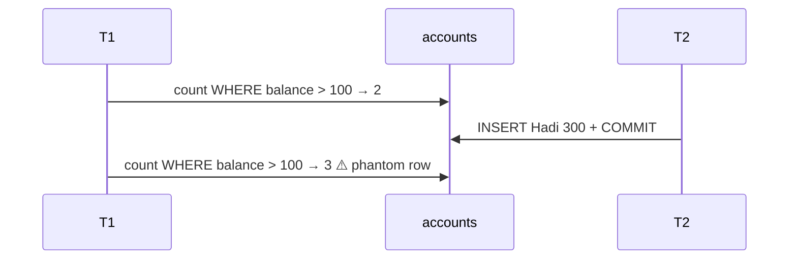

**SQL:**
```sql
-- T1
BEGIN ISOLATION LEVEL READ COMMITTED;
SELECT count(*), sum(balance) FROM accounts WHERE balance > 100;   -- 2 | 1500

-- T2
INSERT INTO accounts VALUES (3, 'Hadi', 300);

-- T1
SELECT count(*), sum(balance) FROM accounts WHERE balance > 100;   -- 3 | 1800 ⚠️
COMMIT;
```

| Level | first → second (measured) |
|---|---|
| Read Uncommitted | 2 · 1500 → 3 · 1800 ⚠️ |
| Read Committed | 2 · 1500 → 3 · 1800 ⚠️ |
| Repeatable Read | 2 · 1500 → 2 · 1500 ✅ |
| Serializable | 2 · 1500 → 2 · 1500 ✅ |

The SQL standard allows phantoms at Repeatable Read. PostgreSQL's snapshot prevents them anyway.

## 4. Lost update

**Definition:** two transactions **read** the same value, compute a new value **in the application**, and **write** it back. The second write overwrites the first, so one change is lost.

**Example:** Ali has 1000. Two withdrawals at the same moment: −100 and −200. Correct result: **700**.

| Step | T1 (withdraw 100) | T2 (withdraw 200) | Ali |
|---|---|---|---|
| 1 | reads 1000 | | 1000 |
| 2 | | reads 1000 | 1000 |
| 3 | | writes 1000 − 200 = 800 + `COMMIT` | 800 |
| 4 | writes 1000 − 100 = 900 + `COMMIT` | | **900** ❌ |

The 200 withdrawal is gone: the money left the account, but the balance shows only −100.

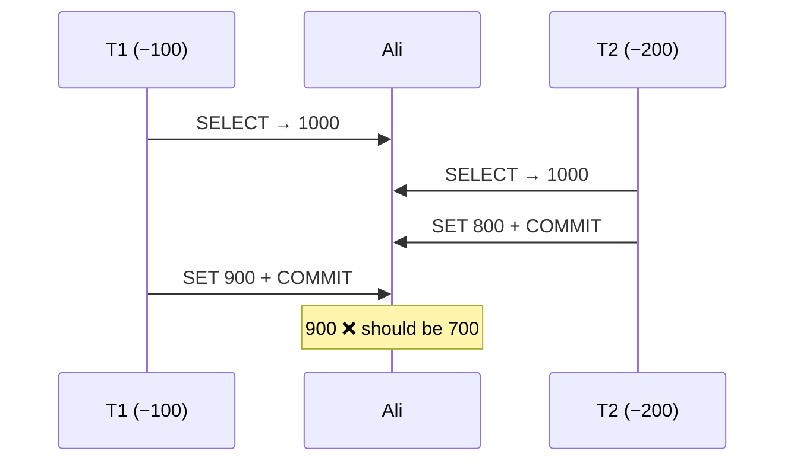

**SQL:**
```sql
-- T1
BEGIN ISOLATION LEVEL READ COMMITTED;
SELECT balance FROM accounts WHERE id = 1;          -- 1000 → app computes 900

-- T2
BEGIN ISOLATION LEVEL READ COMMITTED;
SELECT balance FROM accounts WHERE id = 1;          -- 1000 → app computes 800
UPDATE accounts SET balance = 800 WHERE id = 1;
COMMIT;

-- T1
UPDATE accounts SET balance = 900 WHERE id = 1;     -- overwrites the 800
COMMIT;

SELECT balance FROM accounts WHERE id = 1;          -- 900 ❌
```

| Level | Result (measured) |
|---|---|
| Read Uncommitted | final **900** ⚠️ |
| Read Committed | final **900** ⚠️ |
| Repeatable Read | T1: `ERROR: could not serialize access due to concurrent update` → retry |
| Serializable | T1: same error → retry |

Fixes at Read Committed (atomic `UPDATE`, `FOR UPDATE`): [Level 2 — lost update fixes](#lost-update-and-its-two-fixes).

## 5. Write skew

**Definition:** two transactions read the **same set of rows**, each checks a rule, then each updates a **different** row. No row is written twice, yet together the two changes break the rule.

Difference from #4: in #4 both write the **same** row. In #5 they write **different** rows, so a row-level check can't catch it.

**Example:** hospital rule: **at least one doctor on call**. Omar and Lina are both on call, and both ask to leave at the same moment.

| Step | T1 (Omar) | T2 (Lina) |
|---|---|---|
| 1 | counts on-call doctors → 2 | counts → 2 |
| 2 | "someone else is there" → Omar off | "someone else is there" → Lina off |
| 3 | `COMMIT` | `COMMIT` |
| Result | **nobody on call** ❌ | |

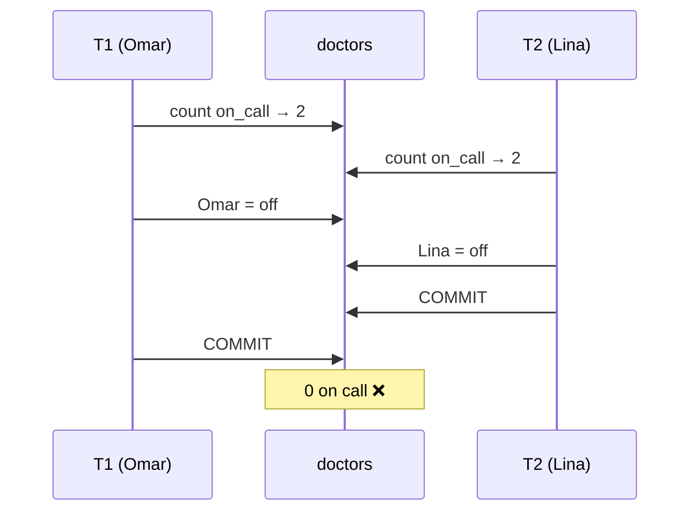

**SQL:**
```sql
-- T1 and T2, both:
BEGIN ISOLATION LEVEL REPEATABLE READ;
SELECT count(*) FROM doctors WHERE on_call;               -- 2

-- T1
UPDATE doctors SET on_call = false WHERE name = 'Omar';
-- T2
UPDATE doctors SET on_call = false WHERE name = 'Lina';   -- doesn't wait: different row

-- T2
COMMIT;
-- T1
COMMIT;

TABLE doctors;
--  Lina | f
--  Omar | f        ← nobody on call ❌
```

| Level | Final `doctors` (measured) |
|---|---|
| Read Uncommitted | Omar `f` · Lina `f` ⚠️ |
| Read Committed | Omar `f` · Lina `f` ⚠️ |
| Repeatable Read | Omar `f` · Lina `f` ⚠️ |
| Serializable | T1: `ERROR: could not serialize access due to read/write dependencies among transactions` → Omar `t` · Lina `f` ✅ |

## Problems × levels (all measured)

| Problem | Read Uncommitted | Read Committed | Repeatable Read | Serializable |
|---|---|---|---|---|
| 1 Dirty read | ✅ | ✅ | ✅ | ✅ |
| 2 Non-repeatable read | ⚠️ 1000 → 900 | ⚠️ 1000 → 900 | ✅ | ✅ |
| 3 Phantom read | ⚠️ 2 → 3 rows | ⚠️ 2 → 3 rows | ✅ | ✅ |
| 4 Lost update | ⚠️ 900 | ⚠️ 900 | ✅ `40001` | ✅ `40001` |
| 5 Write skew | ⚠️ 0 on call | ⚠️ 0 on call | ⚠️ 0 on call | ✅ `40001` |

✅ = prevented · ⚠️ = happens · `40001` = PostgreSQL aborts one transaction, you retry it

---

# Part 2 — The 4 levels

## 1. Snapshot: the one idea behind it all

**Definition:** a **snapshot** is a frozen picture of "which transactions are committed", taken at one moment. You read the data **as of that picture** ([MVCC](03-mvcc.md)). The levels differ in **when the picture is taken** and **what the database checks before letting you write or commit**.

Example: Ali has 1000. T2 commits two changes while T1's transaction is open:

| Time | T1 (one transaction) | T2 | Read Committed sees | Repeatable Read / Serializable sees |
|---|---|---|---|---|
| 10:00 | `BEGIN` · `SELECT balance` | | 1000 📷 | 1000 📷 |
| 10:01 | | set 900 + `COMMIT` | | |
| 10:02 | `SELECT balance` | | **900** 📷 new | **1000** (same 📷) |
| 10:03 | | set 850 + `COMMIT` | | |
| 10:04 | `SELECT balance` | | **850** 📷 new | **1000** (same 📷) |

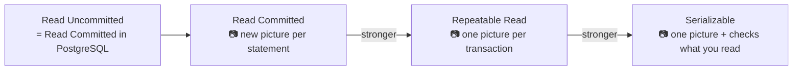

| | Read Uncommitted | Read Committed | Repeatable Read | Serializable |
|---|---|---|---|---|
| Snapshot taken | per statement | per statement | once, first statement | once, first statement |
| Sees uncommitted data | ❌ | ❌ | ❌ | ❌ |
| Sees commits made during my transaction | ✅ next statement | ✅ next statement | ❌ | ❌ |
| A read waits for a writer | ❌ | ❌ | ❌ | ❌ |
| Checked before write/commit | nothing | nothing | rows I **write** | rows I **write** + rows I **read** |
| Needs retry code | no | no | yes | yes |

## 2. Level 1 — Read Uncommitted

**Definition:** in the SQL standard, the weakest level: a transaction may read changes that others **haven't committed** (dirty reads).
**In PostgreSQL** it's accepted by name but **behaves exactly like Read Committed**. Dirty reads never happen.

### What the standard allows vs what PostgreSQL does

Ali has **1000**. A transfer (T2) sets it to 0, then fails.

| Step | T2 (transfer) | T1 reads, standard Read Uncommitted (e.g. SQL Server `NOLOCK`) | T1 reads, PostgreSQL |
|---|---|---|---|
| 1 | `BEGIN`, balance = 0 (not committed) | | |
| 2 | | **0** ❌ | **1000** ✅ |
| 3 | `ROLLBACK` | 0 never existed | |

### How PostgreSQL sees it

1. T2's `UPDATE` doesn't overwrite the row. It writes a **new version** (balance 0) next to the old one (1000).
2. The new version is stamped "created by T2" (`xmin`).
3. T1 reads and asks: "is T2 committed?" → **no** → skip the new version, return 1000.
4. Nothing can turn step 3 off, so no level can see uncommitted data.

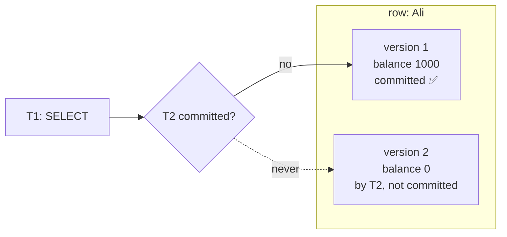

```sql
BEGIN ISOLATION LEVEL READ UNCOMMITTED;           -- accepted
SHOW transaction_isolation;                       -- read uncommitted
SELECT balance FROM accounts WHERE id = 1;        -- 1000 (T2's uncommitted 0 is invisible)
COMMIT;
```

Every problem behaves exactly as in Read Committed (measured): see the matrix above. No reason to use it in PostgreSQL.

## 3. Level 2 — Read Committed (the default)

**Definition:** each **statement** sees everything committed **before that statement started**. A **new snapshot for every statement**.

### How PostgreSQL sees it

For every statement:
1. Take a snapshot: "these transactions are committed right now".
2. A row version is visible if its creator is committed in that snapshot and nobody committed its deletion.
3. Uncommitted versions are always skipped → no dirty reads.
4. A change committed after this statement started → invisible to **this** statement, visible to the **next**.
5. Two writers on the **same row** → the second **waits** for the first's `COMMIT`/`ROLLBACK`, then continues on the **latest committed** version.

### Problems it allows (measured)

| Problem | Result | Why |
|---|---|---|
| Non-repeatable read | 1000 → 900 | 2nd `SELECT` = new snapshot |
| Phantom read | 2 → 3 rows | 2nd `SELECT` = new snapshot |
| Lost update | 900 instead of 700 | the app computed from an old value |
| Write skew | 0 doctors on call | nothing checks what was read |

### Lost update and its two fixes

#### Fix A: let the database compute (atomic UPDATE)

```sql
UPDATE accounts SET balance = balance - 100 WHERE id = 1;   -- T1
UPDATE accounts SET balance = balance - 200 WHERE id = 1;   -- T2
```

| Time | T1 | T2 | Measured |
|---|---|---|---|
| 1 | `BEGIN` · `UPDATE … - 100` → 900 🔒 row locked | | |
| 2 | | `UPDATE … - 200` | ⏳ waits |
| 3 | `COMMIT` 🔓 | | |
| 4 | | re-reads the **latest committed** row (900) → 700 | returns **700** after waiting **1,199 ms** |

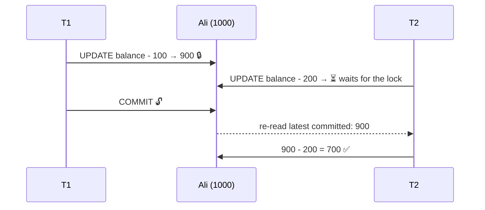

Three things work together:

| Part | Who | Does |
|---|---|---|
| T2 waits | the **row lock** (every `UPDATE` takes one, at any level) | one writer at a time |
| T2 continues on 900 | the **Read Committed** rule | after the wait, use the latest committed version |
| the math uses 900 | `balance - 200` | computed on the row at write time, not on an old app value |

Remove any one and the bug returns:

| Remove | Result |
|---|---|
| the lock | both write at once → lost update |
| Read Committed (use Repeatable Read) | after the wait T2 gets `40001` → must retry |
| `balance - 200` (app sends `SET 800`) | T2 writes 800 over 900 → lost update, even with the lock |

#### Fix B: `SELECT … FOR UPDATE` (when the app must decide)

Use it when the app needs the value first (fraud check, "enough money?").

```sql
BEGIN;
SELECT balance FROM accounts WHERE id = 1 FOR UPDATE;   -- 🔒 lock now
-- app logic …
UPDATE accounts SET balance = <new value> WHERE id = 1;
COMMIT;
```

| Time | T1 | T2 | Measured |
|---|---|---|---|
| 1 | `SELECT … FOR UPDATE` → 1000 🔒 | | |
| 2 | | `SELECT … FOR UPDATE` | ⏳ waits |
| 3 | `UPDATE … = 900` · `COMMIT` | | |
| 4 | | gets **900** (not 1000) → writes 700 | waited **1,201 ms**, final **700** ✅ |

More on locks: [04-locks-deadlocks](04-locks-deadlocks.md).

### Write skew fix: lock what you read

```sql
BEGIN;
SELECT count(*) FROM (
    SELECT 1 FROM doctors WHERE on_call FOR UPDATE   -- 🔒 lock every on-call row
) t;
-- if count >= 2:
UPDATE doctors SET on_call = false WHERE name = 'Omar';
COMMIT;
```

| Time | T1 (Omar) | T2 (Lina) | Measured |
|---|---|---|---|
| 1 | count → 2 🔒 (Omar + Lina rows locked) | | |
| 2 | | same `SELECT … FOR UPDATE` | ⏳ waits |
| 3 | Omar off · `COMMIT` | | |
| 4 | | count → **1** → Lina stays | waited **1,205 ms** · Omar `f` · Lina `t` ✅ |

`count(*)` sits in a sub-query because `SELECT count(*) … FOR UPDATE` gives `ERROR: FOR UPDATE is not allowed with aggregate functions`.

### Surprise: a waiting UPDATE re-checks its WHERE

| Time | T1 | T2 | Measured |
|---|---|---|---|
| 1 | `BEGIN` · `UPDATE … balance - 100` (1000 → 900) | | |
| 2 | | `UPDATE … SET balance = balance + 50 WHERE id = 1 AND balance >= 1000` | ⏳ waits |
| 3 | `COMMIT` | | |
| 4 | | re-checks `balance >= 1000` on 900 → false | **`UPDATE 0`**, Ali stays 900 |

T2 saw 1000 when it started but updated nothing. Always check the affected-row count in the app.

## 4. Level 3 — Repeatable Read

**Definition:** the transaction sees the data **as it was when its first statement started**, until it ends. Changes committed by others after that moment stay invisible. **One snapshot per transaction.**

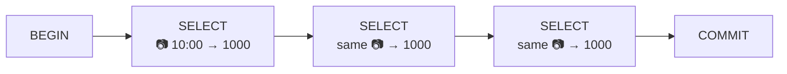

The snapshot is taken at the **first statement**, not at `BEGIN`.

### How PostgreSQL sees it

1. First statement: take a snapshot, keep it for the whole transaction.
2. Every read uses that snapshot → versions committed later are invisible.
3. Before writing a row: "was this row changed by someone who committed **after my snapshot**?"
   - no → write
   - yes → `ERROR 40001: could not serialize access due to concurrent update`
4. Only rows you **write** are checked, not rows you only read → write skew passes.

### Non-repeatable and phantom reads: prevented (measured)

```sql
-- T1
BEGIN ISOLATION LEVEL REPEATABLE READ;
SELECT balance FROM accounts WHERE id = 1;                        -- 1000 📷
SELECT count(*), sum(balance) FROM accounts WHERE balance > 100;  -- 2 | 1500
-- T2: UPDATE accounts SET balance = 900 WHERE id = 1;
-- T2: INSERT INTO accounts VALUES (3, 'Hadi', 300);
SELECT balance FROM accounts WHERE id = 1;                        -- 1000 ✅
SELECT count(*), sum(balance) FROM accounts WHERE balance > 100;  -- 2 | 1500 ✅
COMMIT;
SELECT balance FROM accounts WHERE id = 1;                        -- 900 ← new transaction, new snapshot
```

### Lost update: the database refuses (measured)

Ali has 1000. T1 withdraws 100, T2 withdraws 200:

| Time | T1 (Repeatable Read) | T2 | Measured |
|---|---|---|---|
| 1 | `SELECT balance` → 1000 📷 | | |
| 2 | | `UPDATE … balance - 200` + `COMMIT` | Ali = 800 |
| 3 | `UPDATE … balance - 100` | | ❌ `ERROR: could not serialize access due to concurrent update` |
| 4 | `ROLLBACK` · retry: `BEGIN` · `SELECT` → **800** 📷 new | | |
| 5 | `UPDATE … balance - 100` → **700** · `COMMIT` | | ✅ final 700 |

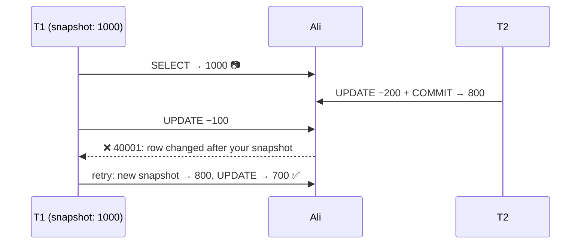

```sql
BEGIN ISOLATION LEVEL REPEATABLE READ;
SELECT balance FROM accounts WHERE id = 1;                 -- 1000
-- T2: UPDATE accounts SET balance = balance - 200 WHERE id = 1;
UPDATE accounts SET balance = balance - 100 WHERE id = 1;
-- ERROR:  could not serialize access due to concurrent update
ROLLBACK;

-- retry the WHOLE transaction
BEGIN ISOLATION LEVEL REPEATABLE READ;
SELECT balance FROM accounts WHERE id = 1;                 -- 800
UPDATE accounts SET balance = balance - 100 WHERE id = 1 RETURNING balance;   -- 700 ✅
COMMIT;
```

Compare: Read Committed waited and continued on 900. Repeatable Read can't continue, because its snapshot still says 1000, so it refuses.

### Write skew: still happens (measured)

Both sessions count 2 doctors on call, each takes itself off a **different** row, both commit → Omar `f` · Lina `f` ⚠️. No row was written twice, so step 3 above finds no conflict. → Serializable.

### When to use it

| ✅ Use | Why |
|---|---|
| Report / export with several queries | all numbers from the same moment, so totals match |
| `BEGIN ISOLATION LEVEL REPEATABLE READ READ ONLY` | consistent view, no `40001` (no writes) |
| `pg_dump` | uses it internally → consistent backup while the app writes |
| Read → decide → write the **same** row | the database detects the conflict for you (+ retry) |

## 5. Level 4 — Serializable

**Definition:** the final result must be the same as if the transactions had run **one after another** (serially). If no serial order could produce what happened, PostgreSQL aborts one transaction with `40001`.

### Why the on-call example is rejected: try every serial order

| Serial order | What would happen | Result |
|---|---|---|
| T1 fully, then T2 | T1: count 2 → Omar off · T2: count **1** → Lina stays | Lina on call ✅ |
| T2 fully, then T1 | T2: count 2 → Lina off · T1: count **1** → Omar stays | Omar on call ✅ |
| **What actually happened** | both counted 2, both left | **nobody** ❌ |

The real result matches **no** serial order → one transaction must go.

### How PostgreSQL sees it

PostgreSQL doesn't try the orders. It tracks dependencies:

1. **Snapshot**: one per transaction, like Repeatable Read.
2. **Reads are recorded**: every row and range a transaction reads gets a light marker (predicate / SIREAD lock). It blocks nobody.
3. **Read → write dependency**: when T2 writes something T1 read (and T1 didn't see it), PostgreSQL records `T1 → T2`.
4. **Cycle check**: if the dependencies form a dangerous cycle, one transaction is aborted, usually at `COMMIT`.

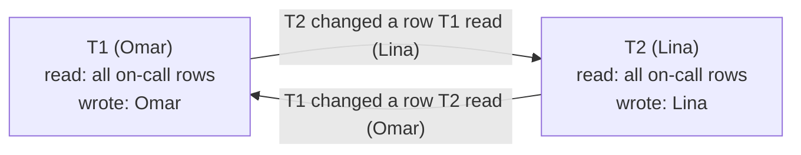

Serializable doesn't **freeze** data and doesn't **prevent** others from writing. T2 commits normally. It **detects** that T1's decision was based on data that changed, and cancels T1.

| | `SELECT … FOR UPDATE` | Serializable |
|---|---|---|
| Can T2 change the rows while T1 runs? | ❌ T2 waits | ✅ T2 commits |
| What happens to T1 | continues normally | aborted at `COMMIT` |
| Style | prevent (pessimistic) | detect (optimistic) |

### SQL, two terminals (measured)

| # | Terminal 1 (Omar) | Terminal 2 (Lina) | Output |
|---|---|---|---|
| 1 | `BEGIN ISOLATION LEVEL SERIALIZABLE;` | | |
| 2 | | `BEGIN ISOLATION LEVEL SERIALIZABLE;` | |
| 3 | `SELECT count(*) FROM doctors WHERE on_call;` | | 2 |
| 4 | | `SELECT count(*) FROM doctors WHERE on_call;` | 2 |
| 5 | `UPDATE doctors SET on_call = false WHERE name = 'Omar';` | | `UPDATE 1` |
| 6 | | `UPDATE doctors SET on_call = false WHERE name = 'Lina';` | `UPDATE 1` (no wait: different row) |
| 7 | | `COMMIT;` | ✅ |
| 8 | `COMMIT;` | | ❌ error below |

```text
ERROR:  could not serialize access due to read/write dependencies among transactions
DETAIL:  Reason code: Canceled on identification as a pivot, during commit attempt.
HINT:  The transaction might succeed if retried.
```

```sql
TABLE doctors;
--  Lina | f
--  Omar | t        ← Omar's transaction was cancelled ✅

-- retry in Terminal 1
BEGIN ISOLATION LEVEL SERIALIZABLE;
SELECT count(*) FROM doctors WHERE on_call;   -- 1  ← new snapshot: Lina already left
-- 1 < 2 → Omar may not leave
ROLLBACK;
```

Same steps with `REPEATABLE READ` → step 8 succeeds → Omar `f` · Lina `f` ❌.

### Retry the whole transaction

`40001` is a normal outcome at Repeatable Read and Serializable, not a bug. Retry from `BEGIN`, reads included: re-running only the failed statement would reuse the old snapshot.

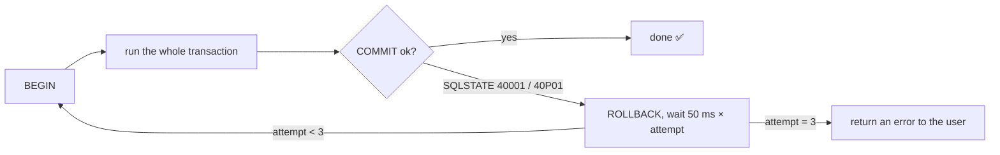

.NET (Npgsql), same pattern as [samples/dotnet/04-WebApi/Program.cs](../../samples/dotnet/04-WebApi/Program.cs):
```csharp
for (var attempt = 1; ; attempt++)
{
    try
    {
        await using var conn = await db.OpenConnectionAsync();
        await using var tx = await conn.BeginTransactionAsync(IsolationLevel.Serializable);
        // … reads + writes …
        await tx.CommitAsync();
        return Results.Ok();
    }
    catch (PostgresException e) when (attempt < 3 && e.SqlState is
        PostgresErrorCodes.SerializationFailure or PostgresErrorCodes.DeadlockDetected)
    {
        await Task.Delay(50 * attempt);   // back off, then retry everything
    }
}
```

### Cost

| | |
|---|---|
| ✅ | reads still never wait for writers |
| ⚠️ | some aborts are false positives (cautious detection) → more retries |
| ⚠️ | tracking reads costs memory/CPU on busy systems |
| ❌ | every code path must handle `40001` |

## 6. Setting the level

```sql
BEGIN ISOLATION LEVEL REPEATABLE READ;          -- for one transaction

BEGIN;
SET TRANSACTION ISOLATION LEVEL SERIALIZABLE;   -- must be the first statement

SHOW transaction_isolation;                     -- check

ALTER DATABASE shop SET default_transaction_isolation = 'repeatable read';   -- default for new sessions
```

.NET: `conn.BeginTransactionAsync(IsolationLevel.Serializable)`.

## 7. Which level when

| Situation | Level |
|---|---|
| Normal web CRUD, with atomic `UPDATE … SET x = x - n` | Read Committed |
| Read → decide in the app → write the **same** row | Read Committed + `FOR UPDATE`, or Repeatable Read + retry |
| Report / export with several queries that must agree | Repeatable Read `READ ONLY` |
| A rule that spans **several rows** (on-call, quota, budget) | Serializable + retry, or Read Committed + `FOR UPDATE` on the rows the rule reads |

## Key Points
- PostgreSQL has **3 real levels**; Read Uncommitted = Read Committed
- Read Committed: new snapshot **per statement** → non-repeatable reads, phantoms, lost updates, write skew possible
- Repeatable Read: **one snapshot** → stable reads; writing a row changed after it → `40001`
- Serializable: also tracks reads → the only level that stops **write skew**
- `40001` is normal → retry the **whole** transaction
- Prefer atomic `UPDATE … SET x = x - n` over read-then-write in the app

Next → [03-mvcc](03-mvcc.md)
