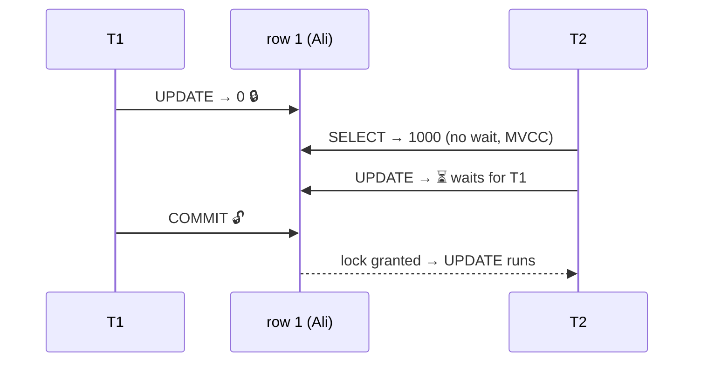
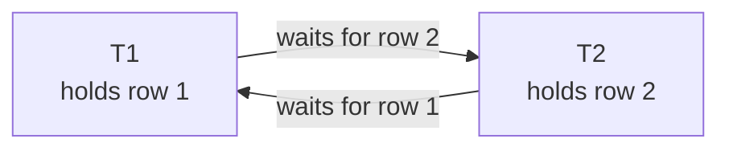
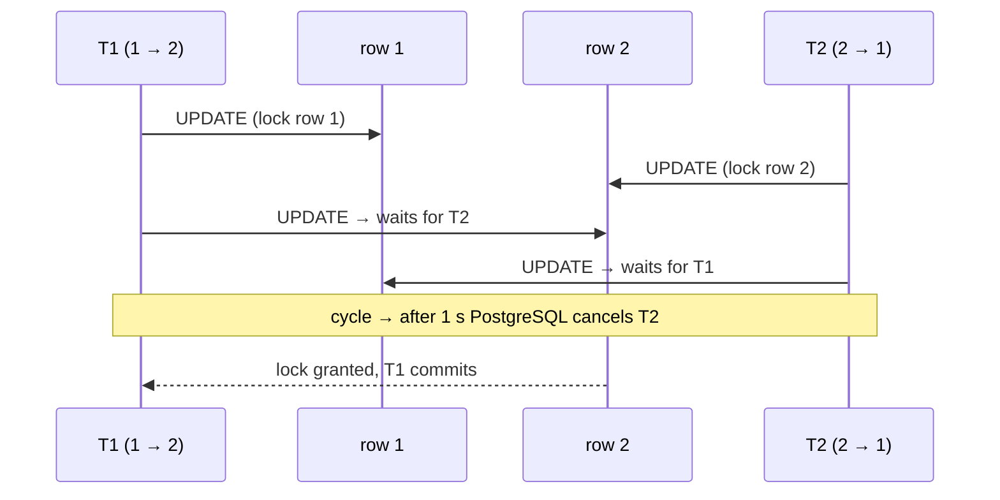
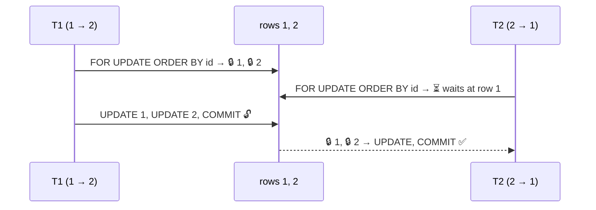
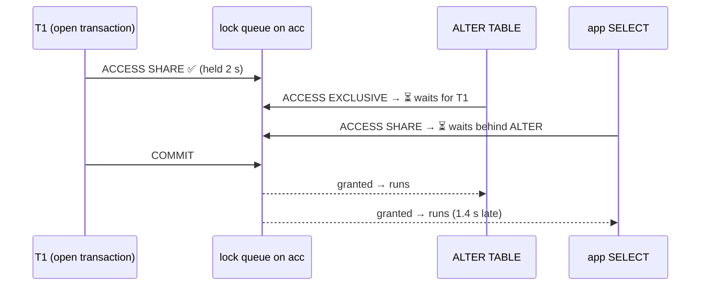
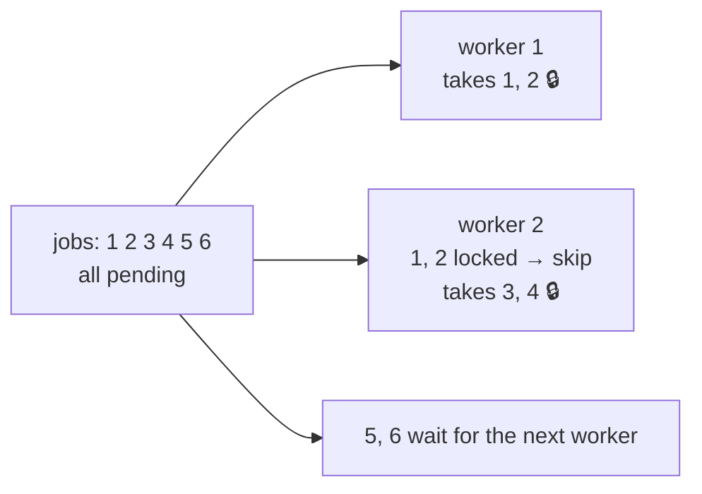

# Locks & Deadlocks

> **Definition:**
> - A **lock** is a marker a transaction puts on a row or a table: "I'm using this, others must wait (or fail)". It's released at `COMMIT` / `ROLLBACK`.
> - A **deadlock** is two transactions each waiting for a lock the other one holds. Neither can ever continue, so PostgreSQL cancels one.
>
> [MVCC](03-mvcc.md) removes most waiting: **readers never wait**. Locks matter when **two writers** touch the same thing.

| Part | Contents |
|---|---|
| [Part 1 — Row locks](#part-1--row-locks) | who waits for whom on the same row · the 4 row lock modes |
| [Part 2 — Deadlocks](#part-2--deadlocks) | how a waiting cycle forms · the fixed-order fix |
| [Part 3 — Table locks](#part-3--table-locks) | lock per statement · why `ALTER TABLE` can freeze a table |
| [Part 4 — Waiting strategies](#part-4--waiting-strategies) | `NOWAIT` · `lock_timeout` · `SKIP LOCKED` job queue |
| [Part 5 — Who blocks whom](#part-5--who-blocks-whom) | find and end the blocker |

## Setup (for every example)

Two terminals: `docker compose exec pg psql -U app -d shop` in each, **T1** and **T2**.

```sql
CREATE TABLE acc (id int PRIMARY KEY, owner text, balance int);
INSERT INTO acc VALUES (1, 'Ali', 1000), (2, 'Sara', 500);

CREATE TABLE jobs (id int PRIMARY KEY, status text);
INSERT INTO jobs SELECT g, 'pending' FROM generate_series(1, 6) g;
```

All outputs below come from running the sessions concurrently on PostgreSQL 17.

---

# Part 1 — Row locks

## 1.1 What a row lock does

**Definition:** every `UPDATE`, `DELETE` or `SELECT … FOR UPDATE` locks the rows it touches until the transaction ends. Another **writer** on the same row waits. **Readers don't.**

**Example:** T1 sets Ali's balance to 0 and hasn't committed yet.

| Step | T1 | T2 | Measured |
|---|---|---|---|
| 1 | `UPDATE` Ali → 0 🔒 (not committed) | | T1 holds row 1 |
| 2 | | reads Ali | **1000** at once: reads the last committed version |
| 3 | | updates Ali | ⏳ waits |
| 4 | `COMMIT` 🔓 | | T2 continues after **1,004 ms** |



**SQL:**
```sql
-- T1
BEGIN;
UPDATE acc SET balance = 0 WHERE id = 1;          -- 🔒 row 1

-- T2
SELECT balance FROM acc WHERE id = 1;             -- 1000, no wait
UPDATE acc SET balance = balance + 1 WHERE id = 1;   -- ⏳ hangs here

-- T1
COMMIT;                                           -- T2's UPDATE finishes now
```

## 1.2 Who waits for a row lock (measured)

T1 holds row 1 with `SELECT … FOR UPDATE`. T2 runs each statement:

| T2 runs | Waits? | Time |
|---|---|---|
| `SELECT balance FROM acc WHERE id = 1` | ❌ | 3.7 ms |
| `UPDATE acc … WHERE id = 1` (same row) | ✅ until T1 ends | **705 ms** |
| `UPDATE acc … WHERE id = 2` (other row) | ❌ | 3.3 ms |
| `INSERT INTO acc VALUES (3, …)` (new row) | ❌ | 2.2 ms |

Only writers on the **same row** wait.

## 1.3 The 4 row lock modes

**Definition:** `SELECT … FOR <mode>` locks rows without changing them. Stronger modes block more.

| Mode | Meaning | Taken automatically by | Use it for |
|---|---|---|---|
| `FOR UPDATE` | I'll change or delete this row | `DELETE`, `UPDATE` of a key column | read → decide → write ([lost update fix](02-isolation-levels.md#lost-update-and-its-two-fixes)) |
| `FOR NO KEY UPDATE` | I'll change non-key columns | normal `UPDATE` | rarely by hand |
| `FOR SHARE` | nobody may change this row while I work | | "this parent must stay as is" |
| `FOR KEY SHARE` | nobody may delete it / change its key | FK check when inserting a child row | rarely by hand |

Conflict matrix (measured: T1 holds the row, T2 requests with `NOWAIT`):

| T1 holds ↓ / T2 requests → | `FOR UPDATE` | `FOR NO KEY UPDATE` | `FOR SHARE` | `FOR KEY SHARE` |
|---|---|---|---|---|
| `FOR UPDATE` | ⏳ | ⏳ | ⏳ | ⏳ |
| `FOR NO KEY UPDATE` | ⏳ | ⏳ | ⏳ | ✅ |
| `FOR SHARE` | ⏳ | ⏳ | ✅ | ✅ |
| `FOR KEY SHARE` | ⏳ | ✅ | ✅ | ✅ |

✅ = granted at once · ⏳ = must wait

Why `FOR NO KEY UPDATE` + `FOR KEY SHARE` = ✅: a normal `UPDATE` of a product's price must not block someone inserting an order that references that product (FK check).

---

# Part 2 — Deadlocks

## 2.1 How a deadlock forms

**Definition:** a **cycle** of waiting: T1 waits for T2, and T2 waits for T1. Waiting longer can't solve it, so PostgreSQL checks for cycles after `deadlock_timeout` (1 s) and cancels one transaction.

**Example:** two transfers at the same moment.
- T1: Ali (1) → Sara (2), 100
- T2: Sara (2) → Ali (1), 50

| Step | T1 (1 → 2) | T2 (2 → 1) | Locks held |
|---|---|---|---|
| 1 | `UPDATE` row 1 🔒 | | T1: row 1 |
| 2 | | `UPDATE` row 2 🔒 | T1: row 1 · T2: row 2 |
| 3 | `UPDATE` row 2 → ⏳ waits for T2 | | |
| 4 | | `UPDATE` row 1 → ⏳ waits for T1 | **cycle** 🔁 |
| 5 | | ❌ cancelled after 1,002 ms | T2 rolled back |
| 6 | gets row 2 → `COMMIT` ✅ | | |





**SQL**, in time order:
```sql
-- T1
BEGIN;
UPDATE acc SET balance = balance - 100 WHERE id = 1;   -- 🔒 row 1

-- T2
BEGIN;
UPDATE acc SET balance = balance - 50 WHERE id = 2;    -- 🔒 row 2

-- T1
UPDATE acc SET balance = balance + 100 WHERE id = 2;   -- ⏳ waits for T2

-- T2
UPDATE acc SET balance = balance + 50 WHERE id = 1;    -- ⏳ waits for T1 → cycle
```

T2 after **1,002 ms**:
```text
ERROR:  deadlock detected
DETAIL:  Process 5596 waits for ShareLock on transaction 51564; blocked by process 5597.
Process 5597 waits for ShareLock on transaction 51563; blocked by process 5596.
HINT:  See server log for query details.
CONTEXT:  while updating tuple (0,6) in relation "acc"
```

Result: T1 committed → `1 = 900`, `2 = 600`. T2 was rolled back entirely → the app must **retry** it (SQLSTATE `40P01`).

## 2.2 Fix: always lock in the same order

A cycle needs two transactions taking locks in **opposite** orders. Make every transaction lock rows **sorted by id** first → the second one waits at the very first lock and never holds a row the first one needs.

| Step | T1 (1 → 2) | T2 (2 → 1) | Measured |
|---|---|---|---|
| 1 | lock rows 1, 2 (in id order) 🔒🔒 | | |
| 2 | | lock rows 1, 2 → ⏳ waits at row 1 (holds nothing) | |
| 3 | update both · `COMMIT` 🔓 | | |
| 4 | | gets rows 1, 2 → updates · `COMMIT` ✅ | waited **808 ms**, no deadlock |



```sql
-- both transfers start the same way
BEGIN;
SELECT id FROM acc WHERE id IN (1, 2) ORDER BY id FOR UPDATE;   -- lock in id order
UPDATE acc SET balance = balance - 100 WHERE id = 1;            -- T2: - 50 on id 2
UPDATE acc SET balance = balance + 100 WHERE id = 2;            -- T2: + 50 on id 1
COMMIT;
```

Final: `1 = 950`, `2 = 550` (1000 − 100 + 50, 500 + 100 − 50). Both succeeded ✅.

## 2.3 Still retry

Other code paths may lock in a different order (triggers, FKs). Treat `40P01` like `40001`: retry the whole transaction ([retry pattern](02-isolation-levels.md#retry-the-whole-transaction)).

---

# Part 3 — Table locks

## 3.1 Every statement takes one

**Definition:** besides row locks, every statement takes a lock on the **table** itself. Most are weak and never conflict with each other. Schema changes take the strongest one.

| Statement | Table lock mode |
|---|---|
| `SELECT` | `ACCESS SHARE` |
| `INSERT` / `UPDATE` / `DELETE` | `ROW EXCLUSIVE` |
| `CREATE INDEX` (not concurrent) | `SHARE` |
| `ALTER TABLE`, `DROP TABLE`, `TRUNCATE`, `VACUUM FULL` | `ACCESS EXCLUSIVE` |

Conflict matrix (measured with `LOCK TABLE … NOWAIT`):

| T1 holds ↓ / T2 requests → | `ACCESS SHARE` (SELECT) | `ROW EXCLUSIVE` (writes) | `SHARE` (CREATE INDEX) | `ACCESS EXCLUSIVE` (ALTER) |
|---|---|---|---|---|
| `ACCESS SHARE` (SELECT) | ✅ | ✅ | ✅ | ⏳ |
| `ROW EXCLUSIVE` (writes) | ✅ | ✅ | ⏳ | ⏳ |
| `SHARE` (CREATE INDEX) | ✅ | ⏳ | ✅ | ⏳ |
| `ACCESS EXCLUSIVE` (ALTER) | ⏳ | ⏳ | ⏳ | ⏳ |

Reading it:
- `SELECT` and writes never block each other at table level (row locks handle writers).
- `CREATE INDEX` blocks **writes** → use `CREATE INDEX CONCURRENTLY` ([measured: an INSERT waited 530 ms](../05-indexes-performance/02-btree.md#7-production-create-index-concurrently-measured)).
- `ALTER TABLE` blocks **everything**, even `SELECT`.

## 3.2 The DDL lock queue

**Definition:** locks are granted **in arrival order**. An `ALTER TABLE` that is **waiting** for its lock already blocks every later query on that table, even a plain `SELECT` that would not conflict with the current holder.

**Example (measured, 3 sessions):**

| Time | T1 | Migration | App `SELECT` | Measured |
|---|---|---|---|---|
| 0.0 s | `BEGIN` · `SELECT count(*) FROM acc` (holds `ACCESS SHARE`, stays open 2 s) | | | |
| 0.3 s | | `ALTER TABLE acc ADD COLUMN note text` → ⏳ waits for T1 | | |
| 0.6 s | | | `SELECT count(*) FROM acc` → ⏳ waits **behind the ALTER** | |
| 2.0 s | `COMMIT` | runs | runs | ALTER waited 1.7 s · SELECT waited **1,407 ms** (normally < 1 ms) |



`pg_stat_activity` during the wait:
```text
 wait_event_type | state  |                 query                  | blocked_by
 Lock            | active | SELECT count(*) FROM acc;              | {6588}      ← blocked by the ALTER
 Lock            | active | ALTER TABLE acc ADD COLUMN note text;  | {6586}      ← blocked by T1
```

On a busy table every request piles up behind the `ALTER` → the API looks down.

✅ **Fix:** give migrations a short `lock_timeout` and retry them:
```sql
SET lock_timeout = '300ms';
ALTER TABLE acc ADD COLUMN note2 text;
-- ERROR:  canceling statement due to lock timeout     (after 303 ms)
-- meanwhile the app SELECT ran in 23 ms instead of 1.4 s
```

---

# Part 4 — Waiting strategies

**Definition:** by default a blocked statement waits **forever**. You can choose to fail fast, wait a limited time, or skip locked rows.

| Strategy | Behaviour when the row is locked | Use for |
|---|---|---|
| default | wait until the holder ends | normal writes |
| `NOWAIT` | error immediately | UI: "someone else is editing this" |
| `SET lock_timeout = '500ms'` | wait up to 500 ms, then error | migrations, APIs with latency limits |
| `SKIP LOCKED` | ignore locked rows, take others | job queues with many workers |

## 4.1 `NOWAIT` and `lock_timeout` (measured)

T1 holds row 1 with `FOR UPDATE`. T2:

| T2 runs | Result | After |
|---|---|---|
| `SELECT * FROM acc WHERE id = 1 FOR UPDATE NOWAIT;` | ❌ `could not obtain lock on row in relation "acc"` | 5 ms |
| `SET lock_timeout = '500ms';` then `SELECT * FROM acc WHERE id = 1 FOR UPDATE;` | ❌ `canceling statement due to lock timeout` | 502 ms |
| `SELECT * FROM acc WHERE id = 2 FOR UPDATE;` | ✅ `2 \| 600`: row 2 is free | 3 ms |

## 4.2 Job queue with `SKIP LOCKED` (measured)

**Example:** 6 pending jobs, 2 workers start at the same moment, each takes 2.

| Step | Worker 1 | Worker 2 |
|---|---|---|
| 1 | picks the first 2 pending → jobs 1, 2 🔒 | |
| 2 | | picks the first 2 pending, **skipping locked** → jobs 3, 4 🔒 |
| 3 | processes · `COMMIT` | processes · `COMMIT` |



```sql
BEGIN;
WITH job AS (
    SELECT id FROM jobs
    WHERE status = 'pending'
    ORDER BY id
    LIMIT 2
    FOR UPDATE SKIP LOCKED          -- skip rows another worker already locked
)
UPDATE jobs SET status = 'working:' || pg_backend_pid()
FROM job WHERE jobs.id = job.id
RETURNING jobs.id;
-- … process …
COMMIT;
```

```text
 id |    status
  1 | working:6516
  2 | working:6516
  3 | working:6517
  4 | working:6517
  5 | pending
  6 | pending
```

Without `SKIP LOCKED`, worker 2 waits for worker 1, then finds jobs 1–2 already taken → workers run one at a time.

---

# Part 5 — Who blocks whom

```sql
SELECT pid, pg_blocking_pids(pid) AS blocked_by, wait_event_type, state,
       now() - xact_start AS xact_age, left(query, 60) AS query
FROM pg_stat_activity
WHERE cardinality(pg_blocking_pids(pid)) > 0;
```

| Column | Tells you |
|---|---|
| `blocked_by` | PIDs holding the lock you wait for |
| `wait_event_type = Lock` | waiting on a lock (not on disk / CPU) |
| `xact_age` | how long the transaction has been open |

Follow `blocked_by` to the **root** blocker (often `idle in transaction`), then:
```sql
SELECT pg_cancel_backend(6586);     -- cancel its current query (gentle)
SELECT pg_terminate_backend(6586);  -- close its connection (its transaction rolls back)
```

## Key Points
- Readers never wait (MVCC); writers on the **same row** queue
- Row lock modes: `FOR UPDATE` blocks all; `FOR KEY SHARE` blocks almost nothing
- Deadlock = waiting cycle → one transaction cancelled after 1 s (`40P01`) → retry
- Prevent deadlocks: lock rows in a fixed order (`ORDER BY id FOR UPDATE`): measured 808 ms wait, no error
- `ALTER TABLE` blocks everything, and a **waiting** `ALTER` blocks everyone behind it → `SET lock_timeout` before migrations
- `NOWAIT` / `lock_timeout` = fail fast · `SKIP LOCKED` = parallel job workers

Lab → [labs/06-transactions-mvcc.sql](../../labs/06-transactions-mvcc.sql)

Next → [05-optimistic-pessimistic](05-optimistic-pessimistic.md)
