# Locks & Deadlocks

> **Definition:**
> - A **lock** is a marker a transaction puts on a row or a table: "I'm using this, others must wait (or fail)". It's released at `COMMIT` / `ROLLBACK`.
> - A **deadlock** is two transactions each waiting for a lock the other one holds. Neither can ever continue, so PostgreSQL cancels one.
>
> [MVCC](03-mvcc.md) removes most waiting: **readers never wait**. Locks matter when **two writers** touch the same thing, or when the **table structure** changes.

| Part | Concepts |
|---|---|
| [Part 0 — Basics](#part-0--basics) | lock · wait · when locks are released · `pg_locks` |
| [Part 1 — Row locks](#part-1--row-locks) | row lock · who waits · `FOR UPDATE OF` · the 4 row lock modes · foreign keys |
| [Part 2 — Deadlocks](#part-2--deadlocks) | waiting cycle · `deadlock_timeout` · fixed lock order |
| [Part 3 — Table locks](#part-3--table-locks) | lock per statement · the 8 modes · `LOCK TABLE` · `CREATE INDEX CONCURRENTLY` · DDL lock queue |
| [Part 4 — Waiting strategies](#part-4--waiting-strategies) | `NOWAIT` · `lock_timeout` vs `statement_timeout` · `SKIP LOCKED` |
| [Part 5 — Advisory locks](#part-5--advisory-locks) | locks on your own IDs, not on rows |
| [Part 6 — Who blocks whom](#part-6--who-blocks-whom) | find the blocker · `idle in transaction` · terminate |

## Setup (for every example)

Open two or three terminals: `docker compose exec pg psql -U app -d shop`. Call them **T1**, **T2**, **T3**.

```sql
CREATE TABLE acc (id int PRIMARY KEY, owner text, balance int);
INSERT INTO acc VALUES (1, 'Ali', 1000), (2, 'Sara', 500);

CREATE TABLE acc_orders (id int PRIMARY KEY, acc_id int REFERENCES acc(id), amount int);
INSERT INTO acc_orders VALUES (10, 1, 100), (11, 1, 50);

CREATE TABLE jobs (id int PRIMARY KEY, status text);
INSERT INTO jobs SELECT g, 'pending' FROM generate_series(1, 6) g;

CREATE TABLE invoices (no int UNIQUE, customer text);
INSERT INTO invoices VALUES (1000, 'old');
```

Tip: name each session so you can recognise it in monitoring queries:
```sql
SET application_name = 'T1';     -- in T1; 'T2' in T2
```

All outputs below come from running the sessions concurrently on PostgreSQL 17.

---

# Part 0 — Basics

## 0.1 Lock

**Definition:** a lock says "this object is in use by transaction X". Another transaction that needs a **conflicting** lock on the same object must wait until X ends.

**Example:** two cashiers want to change Ali's balance at the same time.

| Step | T1 (cashier 1) | T2 (cashier 2) |
|---|---|---|
| 1 | changes Ali's balance → takes a lock on Ali's row 🔒 | |
| 2 | | wants to change Ali's balance → the row is locked → **waits** ⏳ |
| 3 | `COMMIT` → lock released 🔓 | |
| 4 | | gets the lock, makes its change |

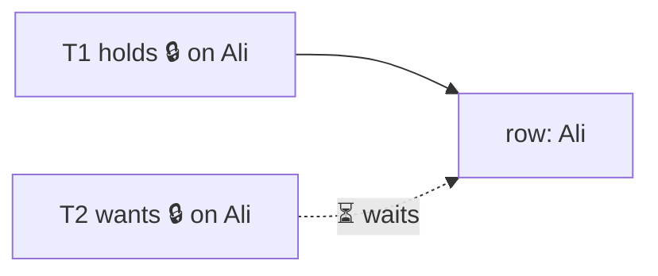

What gets locked:

| Object | Example statement | Typical conflict |
|---|---|---|
| a **row** | `UPDATE acc … WHERE id = 1` | two writers on the same row |
| a **table** | `ALTER TABLE acc …` | schema change vs everyone using the table |
| your own **number** | `pg_advisory_lock(42)` | two app instances running the same job ([Part 5](#part-5--advisory-locks)) |

## 0.2 Waiting

**Definition:** **waiting** = a statement has started but is paused, because a lock it needs is held by another transaction. In `psql` the cursor just hangs with no prompt. By default it waits **forever**, until the holder commits or rolls back.

**Example (measured):** T1 updates Ali and then does nothing for 3 s (the app forgot to commit). T2 tries to update Ali.

| Time | T1 | T2 | T2's screen |
|---|---|---|---|
| 0.0 s | `BEGIN` · `UPDATE … id = 1` 🔒 | | |
| 0.5 s | (idle, transaction still open) | `UPDATE … id = 1` | ⏳ hangs, no prompt |
| 3.0 s | `COMMIT` 🔓 | | |
| 3.0 s | | `UPDATE 1` | done after **2,377 ms** |

What PostgreSQL shows while T2 waits (T3, at 2 s):
```sql
SELECT application_name AS who, state, wait_event_type, wait_event,
       round(extract(epoch FROM now() - state_change)::numeric, 1) AS seconds_in_state,
       left(query, 45) AS query
FROM pg_stat_activity
WHERE application_name IN ('T1', 'T2')
ORDER BY 1;
```
```text
 who |        state        | wait_event_type |  wait_event   | seconds_in_state |                     query
-----+---------------------+-----------------+---------------+------------------+-----------------------------------------------
 T1  | idle in transaction | Client          | ClientRead    |              2.2 | UPDATE acc SET balance = 0 WHERE id = 1;
 T2  | active              | Lock            | transactionid |              1.6 | UPDATE acc SET balance = balance + 1 WHERE id
```

| Column | T1 | T2 |
|---|---|---|
| `state` | `idle in transaction`: transaction open, doing nothing, **still holding its locks** | `active`: running a statement |
| `wait_event_type` | `Client`: waiting for the app to send the next command | **`Lock`**: waiting for a lock |
| `wait_event` | `ClientRead` | `transactionid`: waiting for T1's transaction to end |

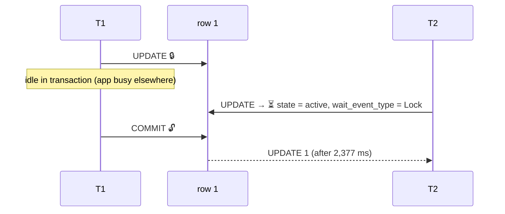

How long to wait is your choice: forever (default), up to a limit (`lock_timeout`), or not at all (`NOWAIT`) → [Part 4](#part-4--waiting-strategies).

## 0.3 When locks are released

**Definition:** a lock is released at the end of the **transaction** (`COMMIT` / `ROLLBACK`), **not** at the end of the statement. A fast statement inside a slow transaction keeps its lock the whole time.

**Example (measured):**

| Time | T1 | T2 | Measured |
|---|---|---|---|
| 0.0 s | `BEGIN` · `UPDATE … SET balance = 900 WHERE id = 1` | | the UPDATE itself took **0.18 ms** |
| 0.0–2.0 s | (more work, no commit yet) | `UPDATE … balance - 50 WHERE id = 1` → ⏳ | |
| 2.0 s | `COMMIT` | | |
| 2.0 s | | → `850` | T2 waited **1,564 ms** |

The statement took 0.18 ms, the lock lasted 2 s. **Lock duration = transaction duration.**

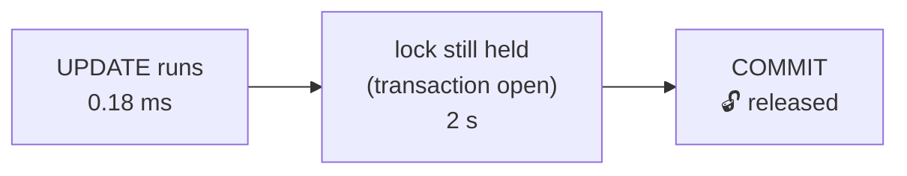

### Exception: `ROLLBACK TO SAVEPOINT`

Undoing part of a transaction also releases the row locks taken in that part:

```sql
-- T1
BEGIN;
SAVEPOINT s;
UPDATE acc SET balance = 0 WHERE id = 1;     -- 🔒 row 1
ROLLBACK TO s;                               -- 🔓 row 1 released, transaction still open

-- T2
UPDATE acc SET balance = balance + 1 WHERE id = 1;   -- 5.2 ms, no wait
```

## 0.4 Seeing locks: `pg_locks`

**Definition:** `pg_locks` is a system view with **one line per lock** held or requested right now.

T1 has an uncommitted `UPDATE` on row 1, T2 is waiting to update the same row. From T3:

```sql
SELECT a.application_name AS who, l.locktype,
       coalesce(l.relation::regclass::text, l.transactionid::text) AS target,
       l.mode, l.granted
FROM pg_locks l JOIN pg_stat_activity a USING (pid)
WHERE a.application_name IN ('T1', 'T2')
  AND l.locktype <> 'virtualxid'
ORDER BY who, locktype, target;
```
```text
 who |   locktype    |  target  |       mode       | granted
-----+---------------+----------+------------------+---------
 T1  | relation      | acc      | RowExclusiveLock | t        ← table lock of an UPDATE (weak)
 T1  | relation      | acc_pkey | RowExclusiveLock | t
 T1  | transactionid | 108443   | ExclusiveLock    | t        ← T1's own transaction ID
 T2  | relation      | acc      | RowExclusiveLock | t        ← table level: no conflict
 T2  | relation      | acc_pkey | RowExclusiveLock | t
 T2  | transactionid | 108443   | ShareLock        | f        ← ⏳ waiting for T1's transaction to end
 T2  | transactionid | 108444   | ExclusiveLock    | t
 T2  | tuple         | acc      | ExclusiveLock    | t        ← "I'm first in line for this row"
```

| Column | Meaning | Values seen above |
|---|---|---|
| `locktype` | what kind of object | `relation` (table/index), `transactionid`, `tuple` (row), `advisory` |
| `mode` | how strong | `RowExclusiveLock`, `ShareLock`, `ExclusiveLock`, … ([Part 3](#32-the-8-table-lock-modes)) |
| `granted` | `t` = holds it · `f` = **waiting** for it | the one `f` line = the waiter |

Where's the row lock? It isn't a line here. It's written **inside the row** (its `xmax` = T1's transaction ID). T2 sees that mark and waits on **T1's transaction ID** instead. To list row locks, see [`pgrowlocks`](#14-the-4-row-lock-modes).

---

# Part 1 — Row locks

## 1.1 What a row lock does

**Definition:** every `UPDATE`, `DELETE` or `SELECT … FOR UPDATE` locks the rows it touches until the transaction ends. Another **writer** on the same row waits. **Readers don't.**

**Example (measured):** T1 sets Ali's balance to 0 and hasn't committed.

| Step | T1 | T2 | Measured |
|---|---|---|---|
| 1 | `UPDATE` Ali → 0 🔒 | | |
| 2 | | reads Ali | **1000** at once: the last committed version |
| 3 | | updates Ali | ⏳ waits |
| 4 | `COMMIT` 🔓 | | T2 continues after **1,004 ms** |

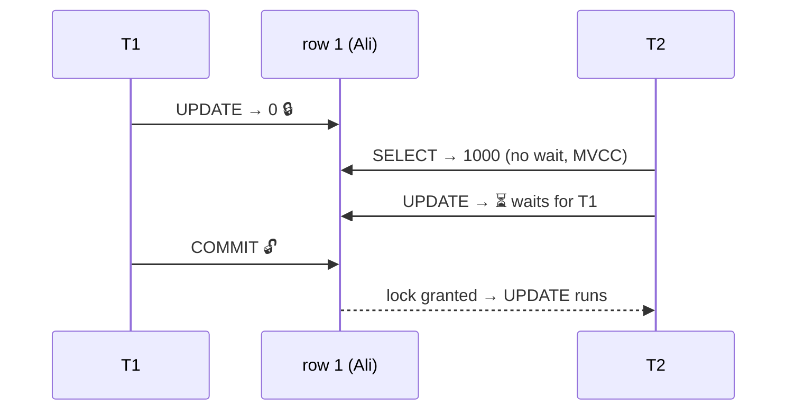

```sql
-- T1
BEGIN;
UPDATE acc SET balance = 0 WHERE id = 1;             -- 🔒 row 1

-- T2
SELECT balance FROM acc WHERE id = 1;                -- 1000, no wait
UPDATE acc SET balance = balance + 1 WHERE id = 1;   -- ⏳ hangs here

-- T1
COMMIT;                                              -- T2's UPDATE finishes now
```

## 1.2 Who waits for a row lock

**Example (measured):** T1 holds row 1 with `SELECT … FOR UPDATE`. T2 runs four statements:

```sql
-- T1
BEGIN;
SELECT * FROM acc WHERE id = 1 FOR UPDATE;              -- 🔒 row 1

-- T2 (\timing on)
SELECT balance FROM acc WHERE id = 1;                   -- 3.7 ms   ✅ reader
UPDATE acc SET balance = balance WHERE id = 2;          -- 3.3 ms   ✅ other row
INSERT INTO acc VALUES (3, 'Hadi', 300);                -- 2.2 ms   ✅ new row
UPDATE acc SET balance = balance WHERE id = 1;          -- ⏳ until T1 ends (705 ms here)

-- T1
ROLLBACK;
```

| T2 runs | Waits? | Time |
|---|---|---|
| read the locked row | ❌ | 3.7 ms |
| update **another** row | ❌ | 3.3 ms |
| insert a **new** row | ❌ | 2.2 ms |
| update the **locked** row | ✅ | **705 ms** |

Only writers on the **same row** wait.

## 1.3 `FOR UPDATE OF`: lock only one table of a join

**Definition:** `SELECT … FOR UPDATE` on a join locks the matching rows of **every** table in it. `FOR UPDATE OF <alias>` locks rows of the named table only.

**Example (measured):** T1 wants to change order 10 and reads its owner's name through a join. It should not lock the owner (Ali), because other orders of Ali must stay editable.

| T1 query (held open) | T2: `UPDATE acc … WHERE id = 1` (Ali), `lock_timeout = 500ms` |
|---|---|
| `… FOR UPDATE` | ❌ `canceling statement due to lock timeout` (502 ms): Ali was locked too |
| `… FOR UPDATE OF o` | ✅ 4 ms: only the order row is locked |

```sql
-- T1
BEGIN;
SELECT o.id, a.owner
FROM acc_orders o JOIN acc a ON a.id = o.acc_id
WHERE o.id = 10
FOR UPDATE OF o;                                   -- 🔒 only acc_orders row 10

-- T2
UPDATE acc SET balance = balance WHERE id = 1;     -- ✅ 4 ms
SET lock_timeout = '500ms';
UPDATE acc_orders SET amount = amount WHERE id = 10;
-- ERROR:  canceling statement due to lock timeout  (501 ms)   ← the order row is locked
```

## 1.4 The 4 row lock modes

**Definition:** `SELECT … FOR <mode>` locks rows without changing them. Stronger modes block more.

| Mode | Meaning | Taken automatically by | Use it for |
|---|---|---|---|
| `FOR UPDATE` | I'll change or delete this row | `DELETE`, `UPDATE` of a key column | read → decide → write ([lost update fix](02-isolation-levels.md#lost-update-and-its-two-fixes)) |
| `FOR NO KEY UPDATE` | I'll change non-key columns | normal `UPDATE` | rarely by hand |
| `FOR SHARE` | nobody may change this row while I work | | "this parent must stay as is" |
| `FOR KEY SHARE` | nobody may delete it / change its key | FK check when inserting a child row | rarely by hand |

Conflict matrix (measured: T1 holds the row, T2 requests with `NOWAIT`):

| T1 holds ↓ / T2 requests → | `FOR UPDATE` | `FOR NO KEY UPDATE` | `FOR SHARE` | `FOR KEY SHARE` |
|---|---|---|---|---|
| `FOR UPDATE` | ⏳ | ⏳ | ⏳ | ⏳ |
| `FOR NO KEY UPDATE` | ⏳ | ⏳ | ⏳ | ✅ |
| `FOR SHARE` | ⏳ | ⏳ | ✅ | ✅ |
| `FOR KEY SHARE` | ⏳ | ✅ | ✅ | ✅ |

✅ = granted at once · ⏳ = must wait

Try one cell:
```sql
-- T1
BEGIN;
SELECT * FROM acc WHERE id = 1 FOR SHARE;

-- T2
SELECT id FROM acc WHERE id = 1 FOR SHARE NOWAIT;     -- ✅ 1          (share + share)
SELECT id FROM acc WHERE id = 1 FOR UPDATE NOWAIT;    -- ❌ ERROR:  could not obtain lock on row in relation "acc"
```

List the locked rows and their mode (extension `pgrowlocks`, ships with PostgreSQL):
```sql
-- T1
BEGIN;
SELECT * FROM acc WHERE id = 1 FOR UPDATE;
SELECT * FROM acc WHERE id = 2 FOR SHARE;

-- T3
CREATE EXTENSION IF NOT EXISTS pgrowlocks;
SELECT locked_row, multi, modes FROM pgrowlocks('acc');
--  locked_row | multi |     modes
--  (0,1)      | f     | {"For Update"}
--  (0,2)      | f     | {"For Share"}
```

## 1.5 Why the weak modes exist: foreign keys

**Definition:** inserting a child row (an order) makes PostgreSQL lock the parent row (the account) with `FOR KEY SHARE`, so the parent can't be deleted before the insert commits.

**Example (measured):** T1 holds a change on account 1 or 2. T2 inserts an order for that account:

| T1 holds (open transaction) | Row lock T1 takes | T2: `INSERT INTO acc_orders VALUES (…, <same account>, 10)` |
|---|---|---|
| `UPDATE acc SET balance = balance + 1 WHERE id = 1` | `FOR NO KEY UPDATE` | ✅ 10 ms, no wait |
| `UPDATE acc SET id = 3 WHERE id = 1` (key changes) | `FOR UPDATE` | ⏳ waits **909 ms** |
| `DELETE FROM acc WHERE id = 2` | `FOR UPDATE` | ⏳ waits **906 ms** |

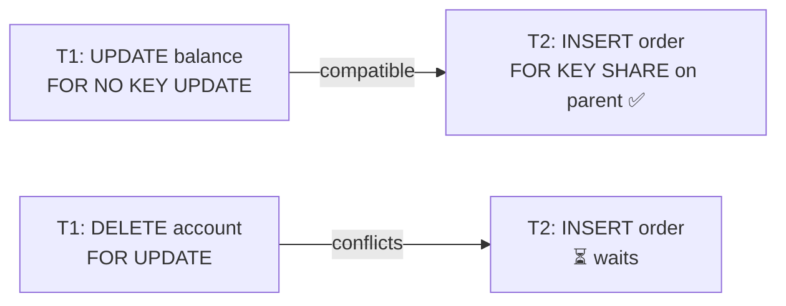

A normal `UPDATE` of a balance (or a product's price) never blocks inserting orders that reference it. Only changing or deleting the **key** does.

---

# Part 2 — Deadlocks

## 2.1 How a deadlock forms

**Definition:** a **cycle** of waiting: T1 waits for T2, and T2 waits for T1. Waiting longer can't solve it. After `deadlock_timeout` (1 s) PostgreSQL checks for a cycle and cancels one transaction.

**Example (measured):** two transfers at the same moment.
- T1: Ali (1) → Sara (2), 100
- T2: Sara (2) → Ali (1), 50

| Step | T1 (1 → 2) | T2 (2 → 1) | Locks held |
|---|---|---|---|
| 1 | `UPDATE` row 1 🔒 | | T1: row 1 |
| 2 | | `UPDATE` row 2 🔒 | T1: row 1 · T2: row 2 |
| 3 | `UPDATE` row 2 → ⏳ waits for T2 | | |
| 4 | | `UPDATE` row 1 → ⏳ waits for T1 | **cycle** 🔁 |
| 5 | | ❌ cancelled after 1,002 ms | T2 rolled back |
| 6 | gets row 2 → `COMMIT` ✅ | | |

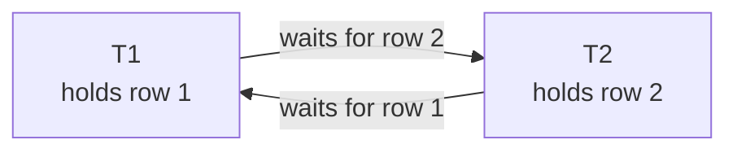

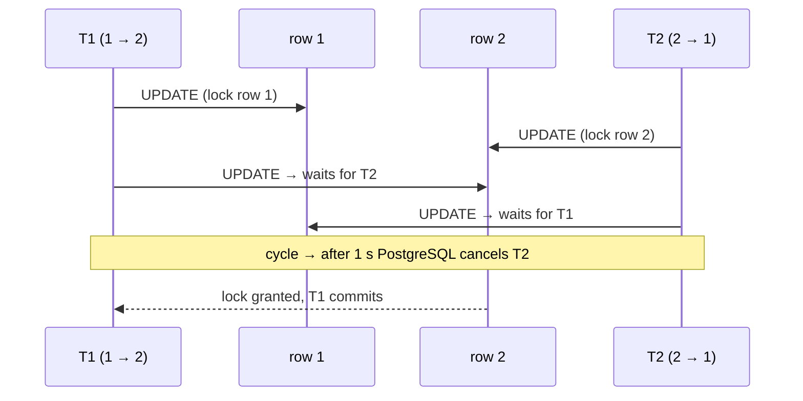

**SQL**, in time order:
```sql
-- T1
BEGIN;
UPDATE acc SET balance = balance - 100 WHERE id = 1;   -- 🔒 row 1

-- T2
BEGIN;
UPDATE acc SET balance = balance - 50 WHERE id = 2;    -- 🔒 row 2

-- T1
UPDATE acc SET balance = balance + 100 WHERE id = 2;   -- ⏳ waits for T2

-- T2
UPDATE acc SET balance = balance + 50 WHERE id = 1;    -- ⏳ waits for T1 → cycle
```

T2 after **1,002 ms**:
```text
ERROR:  deadlock detected
DETAIL:  Process 5596 waits for ShareLock on transaction 51564; blocked by process 5597.
Process 5597 waits for ShareLock on transaction 51563; blocked by process 5596.
HINT:  See server log for query details.
CONTEXT:  while updating tuple (0,6) in relation "acc"
```

Result: T1 committed → `1 = 900`, `2 = 600`. T2 was rolled back entirely → the app must **retry** it (SQLSTATE `40P01`).

```sql
SHOW deadlock_timeout;        -- 1s: wait this long before checking for a cycle
-- in T2 after the error:
SELECT 1 FROM acc;
-- ERROR:  current transaction is aborted, commands ignored until end of transaction block
ROLLBACK;                     -- required before T2 can do anything
```

## 2.2 Fix: always lock in the same order

**Definition:** a cycle needs two transactions taking locks in **opposite** orders. If every transaction locks rows **sorted by id** first, the second one waits at the very first lock and never holds a row the first one needs.

**Example (measured):**

| Step | T1 (1 → 2) | T2 (2 → 1) | Measured |
|---|---|---|---|
| 1 | lock rows 1, 2 (in id order) 🔒🔒 | | |
| 2 | | lock rows 1, 2 → ⏳ waits at row 1 (holds nothing) | |
| 3 | update both · `COMMIT` 🔓 | | |
| 4 | | gets rows 1, 2 → updates · `COMMIT` ✅ | waited **808 ms**, no deadlock |

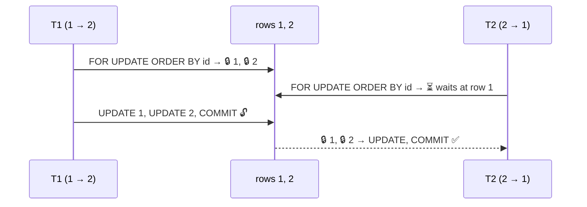

```sql
-- both transfers start the same way
BEGIN;
SELECT id FROM acc WHERE id IN (1, 2) ORDER BY id FOR UPDATE;   -- lock in id order
UPDATE acc SET balance = balance - 100 WHERE id = 1;            -- T2: - 50 on id 2
UPDATE acc SET balance = balance + 100 WHERE id = 2;            -- T2: + 50 on id 1
COMMIT;
```

Final: `1 = 950`, `2 = 550` (1000 − 100 + 50, 500 + 100 − 50). Both succeeded ✅.

## 2.3 Still retry

Other code paths may lock in a different order (triggers, FKs). Treat `40P01` like `40001`: retry the whole transaction ([retry pattern](02-isolation-levels.md#retry-the-whole-transaction)).

---

# Part 3 — Table locks

## 3.1 Every statement takes one

**Definition:** besides row locks, every statement takes a lock on the **table** itself. Most are weak and never conflict with each other. Schema changes take the strongest one.

**Example:** run a statement inside a transaction, then ask `pg_locks` what your own session holds on `acc`:

```sql
BEGIN;
UPDATE acc SET balance = balance WHERE id = 1;          -- replace with each statement below
SELECT mode FROM pg_locks
WHERE pid = pg_backend_pid() AND relation = 'acc'::regclass;
ROLLBACK;
```

| Statement inside the transaction | Table lock (measured) |
|---|---|
| `SELECT count(*) FROM acc` | `AccessShareLock` |
| `SELECT * FROM acc WHERE id = 1 FOR UPDATE` | `RowShareLock` |
| `UPDATE acc SET balance = balance WHERE id = 1` | `RowExclusiveLock` |
| `ANALYZE acc` | `ShareUpdateExclusiveLock` |
| `ALTER TABLE acc VALIDATE CONSTRAINT c` | `ShareUpdateExclusiveLock` |
| `CREATE INDEX tmp_acc_owner ON acc (owner)` | `ShareLock` |
| `CREATE TRIGGER t BEFORE UPDATE ON acc …` | `ShareRowExclusiveLock` |
| `ALTER TABLE acc ADD COLUMN note text` | `AccessExclusiveLock` |
| `ALTER TABLE acc ADD CONSTRAINT c CHECK (…) NOT VALID` | `AccessExclusiveLock` |

From the PostgreSQL docs (can't run inside a transaction block, or drop the table): `VACUUM` / `CREATE INDEX CONCURRENTLY` → `ShareUpdateExclusiveLock` · `REFRESH MATERIALIZED VIEW CONCURRENTLY` → `ExclusiveLock` · `TRUNCATE`, `DROP TABLE`, `VACUUM FULL`, plain `REFRESH MATERIALIZED VIEW` → `AccessExclusiveLock`.

## 3.2 The 8 table lock modes

**Definition:** 8 strengths, from weakest (`ACCESS SHARE`) to strongest (`ACCESS EXCLUSIVE`). Two modes either **conflict** (the second waits) or don't.

Conflict matrix (measured: T1 holds `LOCK TABLE acc IN <row> MODE`, T2 requests `<column> MODE NOWAIT`):

| T1 holds ↓ / T2 requests → | ACCESS SHARE | ROW SHARE | ROW EXCL | SHARE UPD EXCL | SHARE | SHARE ROW EXCL | EXCLUSIVE | ACCESS EXCL |
|---|---|---|---|---|---|---|---|---|
| **ACCESS SHARE** (`SELECT`) | ✅ | ✅ | ✅ | ✅ | ✅ | ✅ | ✅ | ⏳ |
| **ROW SHARE** (`FOR UPDATE`) | ✅ | ✅ | ✅ | ✅ | ✅ | ✅ | ⏳ | ⏳ |
| **ROW EXCLUSIVE** (`INSERT/UPDATE/DELETE`) | ✅ | ✅ | ✅ | ✅ | ⏳ | ⏳ | ⏳ | ⏳ |
| **SHARE UPDATE EXCLUSIVE** (`VACUUM`, `ANALYZE`) | ✅ | ✅ | ✅ | ⏳ | ⏳ | ⏳ | ⏳ | ⏳ |
| **SHARE** (`CREATE INDEX`) | ✅ | ✅ | ⏳ | ⏳ | ✅ | ⏳ | ⏳ | ⏳ |
| **SHARE ROW EXCLUSIVE** (`CREATE TRIGGER`) | ✅ | ✅ | ⏳ | ⏳ | ⏳ | ⏳ | ⏳ | ⏳ |
| **EXCLUSIVE** (`REFRESH … CONCURRENTLY`) | ✅ | ⏳ | ⏳ | ⏳ | ⏳ | ⏳ | ⏳ | ⏳ |
| **ACCESS EXCLUSIVE** (`ALTER`, `DROP`, `TRUNCATE`) | ⏳ | ⏳ | ⏳ | ⏳ | ⏳ | ⏳ | ⏳ | ⏳ |

✅ = no conflict · ⏳ = must wait

The 4 lines that matter in daily work:

| If T1 runs… | it blocks… | it does **not** block… |
|---|---|---|
| `SELECT` | only `ALTER` / `DROP` / `TRUNCATE` / `VACUUM FULL` | reads, writes, `CREATE INDEX`, `VACUUM` |
| `INSERT` / `UPDATE` / `DELETE` | `CREATE INDEX`, `CREATE TRIGGER`, `ALTER` | reads, other writes (row locks handle those), `VACUUM` |
| `CREATE INDEX` | **all writes** | reads, other `CREATE INDEX` |
| `ALTER TABLE` | **everything, even `SELECT`** | nothing |

Try one row of the matrix:
```sql
-- T1: a reader with an open transaction (holds ACCESS SHARE)
BEGIN;
SELECT count(*) FROM acc;

-- T2
BEGIN;
LOCK TABLE acc IN ROW EXCLUSIVE MODE NOWAIT;      -- ✅ LOCK TABLE          (what writes need)
ROLLBACK;
BEGIN;
LOCK TABLE acc IN ACCESS EXCLUSIVE MODE NOWAIT;   -- ❌ ERROR:  could not obtain lock on relation "acc"   (what ALTER needs)
ROLLBACK;
```

## 3.3 `LOCK TABLE`: taking a table lock yourself

**Definition:** `LOCK TABLE name IN <mode> MODE` takes a table lock explicitly, held until the end of the transaction. Use it when a rule involves **the whole table** and row locks can't express it, e.g. "the next number is max + 1".

**Example (measured): gapless invoice numbers.** Each new invoice must get `max(no) + 1`. Two cashiers create invoices at the same moment.

### ❌ Without `LOCK TABLE`

| Step | T1 (cashier A) | T2 (cashier B) |
|---|---|---|
| 1 | `max(no) + 1` → **1001** | |
| 2 | | `max(no) + 1` → **1001** (same!) |
| 3 | | inserts 1001 ✅ |
| 4 | inserts 1001 → ❌ `duplicate key value violates unique constraint "invoices_no_key"` | |

Row locks can't help: there is no row "1001" to lock yet, and `max()` can't be locked with `FOR UPDATE`.

### ✅ With `LOCK TABLE … IN EXCLUSIVE MODE`

`EXCLUSIVE` blocks every other writer (and another `EXCLUSIVE`), but **not readers**.

| Step | T1 (cashier A) | T2 (cashier B) | Report (T3) | Measured |
|---|---|---|---|---|
| 1 | `LOCK TABLE invoices IN EXCLUSIVE MODE` 🔒 · `max + 1` → 1001 | | | |
| 2 | | `LOCK TABLE …` → ⏳ waits | | |
| 3 | | | `SELECT count(*) FROM invoices` | ✅ **0.9 ms**, readers not blocked |
| 4 | inserts 1001 · `COMMIT` 🔓 | | | |
| 5 | | gets the lock · `max + 1` → **1002** · inserts · `COMMIT` | | waited **750 ms** |

Final: `1000:old 1001:A 1002:B` ✅

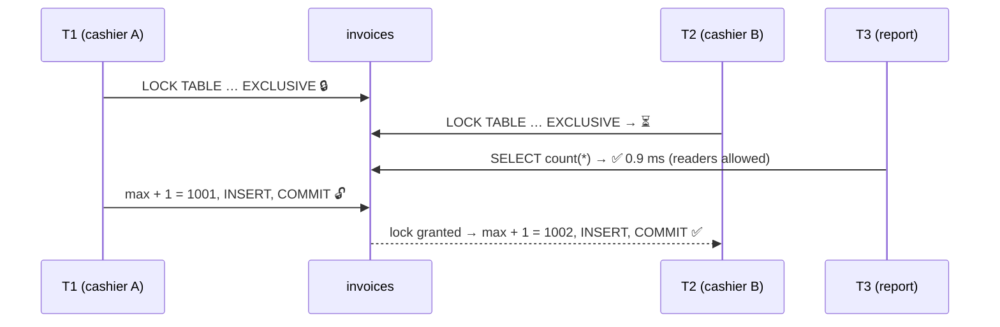

```sql
BEGIN;
LOCK TABLE invoices IN EXCLUSIVE MODE;                       -- 🔒 one invoice creator at a time
INSERT INTO invoices (no, customer)
SELECT max(no) + 1, 'A' FROM invoices;
COMMIT;                                                      -- 🔓
```

| `LOCK TABLE` variant | Use |
|---|---|
| `IN EXCLUSIVE MODE` | serialize writers, keep readers working (above) |
| `IN SHARE MODE` | freeze the data for a consistent multi-step check: others can read, nobody can write |
| `IN ACCESS EXCLUSIVE MODE` | nobody may even read (maintenance) |
| `… NOWAIT` | fail at once instead of waiting |

⚠️ A table lock serializes **all** writers of the table. Fine for invoices (a few per second). For high-volume IDs use a `SEQUENCE` / `IDENTITY` (fast, but may leave gaps after a rollback).

## 3.4 `CREATE INDEX` vs `CREATE INDEX CONCURRENTLY`

**Definition:** `CREATE INDEX` takes `SHARE` → **blocks writes** while it builds. `CONCURRENTLY` takes the weaker `SHARE UPDATE EXCLUSIVE` → writes continue, the build is slower.

**Example (measured, [02-btree](../05-indexes-performance/02-btree.md#7-production-create-index-concurrently-measured)):** build an index on 1M `orders` while an `INSERT` arrives:

| Build | Build time | Concurrent `INSERT` |
|---|---|---|
| `CREATE INDEX` | 0.80 s | waited **530 ms** ❌ |
| `CREATE INDEX CONCURRENTLY` | 0.96 s | **3 ms** ✅ |

```sql
CREATE INDEX CONCURRENTLY orders_created_idx ON orders (created_at);   -- not inside BEGIN … COMMIT
```

## 3.5 The DDL lock queue

**Definition:** lock requests are served **in arrival order**. An `ALTER TABLE` that is **waiting** already blocks every later query on that table, even a plain `SELECT` that wouldn't conflict with the current holder.

**Example (measured, 3 sessions):**

| Time | T1 | Migration | App `SELECT` | Measured |
|---|---|---|---|---|
| 0.0 s | `BEGIN` · `SELECT count(*) FROM acc` (holds `ACCESS SHARE`, stays open 2 s) | | | |
| 0.3 s | | `ALTER TABLE acc ADD COLUMN note text` → ⏳ waits for T1 | | |
| 0.6 s | | | `SELECT count(*) FROM acc` → ⏳ waits **behind the ALTER** | |
| 2.0 s | `COMMIT` | runs | runs | ALTER waited 1.7 s · SELECT waited **1,407 ms** (normally < 1 ms) |

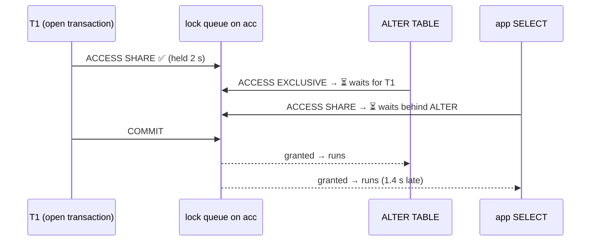

```sql
-- T1 (e.g. a report that forgot to COMMIT)
BEGIN;
SELECT count(*) FROM acc;                         -- holds ACCESS SHARE until COMMIT

-- T2: migration
ALTER TABLE acc ADD COLUMN note text;             -- ⏳ needs ACCESS EXCLUSIVE → waits for T1

-- T3: app
SELECT count(*) FROM acc;                         -- ⏳ waits behind the ALTER (1,407 ms)

-- T1
COMMIT;                                           -- ALTER runs, then the app SELECT
```

`pg_stat_activity` during the wait:
```text
 wait_event_type | state  |                 query                  | blocked_by
 Lock            | active | SELECT count(*) FROM acc;              | {6588}      ← blocked by the ALTER
 Lock            | active | ALTER TABLE acc ADD COLUMN note text;  | {6586}      ← blocked by T1
```

On a busy table every request piles up behind the `ALTER` → the API looks down.

✅ **Fix:** give migrations a short `lock_timeout` and retry them:
```sql
SET lock_timeout = '300ms';
ALTER TABLE acc ADD COLUMN note2 text;
-- ERROR:  canceling statement due to lock timeout     (after 303 ms)
-- meanwhile the app SELECT ran in 23 ms instead of 1.4 s
```

---

# Part 4 — Waiting strategies

**Definition:** by default a blocked statement waits **forever**. You choose instead to fail fast, wait a limited time, or skip locked rows.

| Strategy | When the row/table is locked | Use for |
|---|---|---|
| default | wait until the holder ends | normal writes |
| `NOWAIT` | error immediately | UI: "someone else is editing this" |
| `lock_timeout = '500ms'` | wait up to 500 ms, then error | migrations, APIs with latency limits |
| `statement_timeout = '…'` | cancel the statement after X ms, **whatever** it waits for | cap slow queries |
| `SKIP LOCKED` | ignore locked rows, take others | job queues with many workers |

## 4.1 `NOWAIT` and `lock_timeout`

**Example (measured):** T1 holds row 1 with `FOR UPDATE`. T2:

```sql
-- T1
BEGIN;
SELECT * FROM acc WHERE id = 1 FOR UPDATE;            -- 🔒 row 1

-- T2 (\timing on)
SELECT * FROM acc WHERE id = 1 FOR UPDATE NOWAIT;
-- ERROR:  could not obtain lock on row in relation "acc"          Time: 0.7 ms

SET lock_timeout = '500ms';
SELECT * FROM acc WHERE id = 1 FOR UPDATE;
-- ERROR:  canceling statement due to lock timeout
-- CONTEXT:  while locking tuple (0,1) in relation "acc"           Time: 501.6 ms

SELECT * FROM acc WHERE id = 2 FOR UPDATE;
--  2 | Sara | 500                                                Time: 6.2 ms   ← row 2 is free

RESET lock_timeout;                                   -- back to "wait forever"
```

`SET` lasts for the session. `SET LOCAL lock_timeout = …` inside a transaction limits it to that transaction.

## 4.2 `lock_timeout` vs `statement_timeout`

**Definition:**
- `lock_timeout` = the max time to **wait for a lock**. Only lock waits are cancelled.
- `statement_timeout` = the max time for the **whole statement**, whatever it's doing (waiting for a lock, reading 10 GB, `pg_sleep`).

**Example (measured, both set to 700 ms):** T1 holds row 1. T2 runs a blocked `UPDATE` and a slow query that needs no lock:

| T2 runs | `statement_timeout = '700ms'` | `lock_timeout = '700ms'` |
|---|---|---|
| `UPDATE acc … WHERE id = 1` (row locked) | ❌ `canceling statement due to statement timeout` (701 ms) | ❌ `canceling statement due to lock timeout` (702 ms) |
| `SELECT pg_sleep(1)` (slow, no lock) | ❌ `canceling statement due to statement timeout` (701 ms) | ✅ finished (1,002 ms) |

```sql
SET statement_timeout = '700ms';
UPDATE acc SET balance = 1 WHERE id = 1;   -- ERROR: canceling statement due to statement timeout
SELECT pg_sleep(1);                        -- ERROR: canceling statement due to statement timeout
RESET statement_timeout;

SET lock_timeout = '700ms';
UPDATE acc SET balance = 1 WHERE id = 1;   -- ERROR: canceling statement due to lock timeout
SELECT pg_sleep(1);                        -- ✅ not a lock wait → runs to the end
```

Typical setup: `lock_timeout` short for migrations (seconds), `statement_timeout` as a safety cap per role (`ALTER ROLE app_rw SET statement_timeout = '30s'`).

## 4.3 `SKIP LOCKED`: job queue

**Definition:** `FOR UPDATE SKIP LOCKED` locks the matching rows that are free and **silently skips** rows another transaction has locked. Several workers can then take different jobs at the same moment.

**Example (measured):** 6 pending jobs, 2 workers start at the same moment, each takes 2.

| Step | Worker 1 | Worker 2 |
|---|---|---|
| 1 | picks the first 2 pending → jobs 1, 2 🔒 | |
| 2 | | picks the first 2 pending, **skipping locked** → jobs 3, 4 🔒 |
| 3 | processes · `COMMIT` | processes · `COMMIT` |

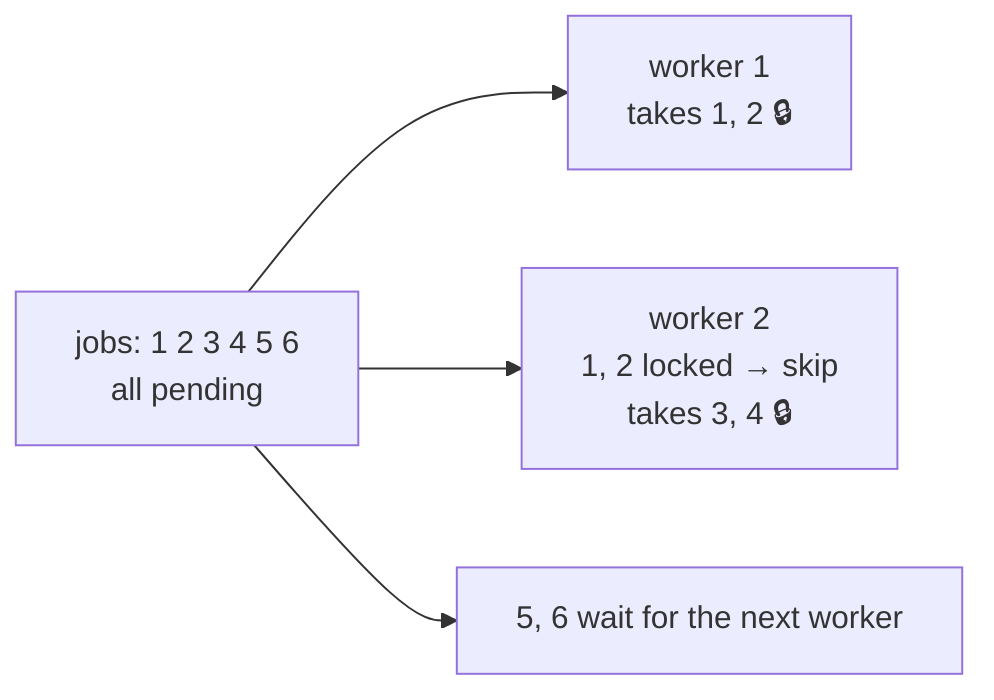

```sql
BEGIN;
WITH job AS (
    SELECT id FROM jobs
    WHERE status = 'pending'
    ORDER BY id
    LIMIT 2
    FOR UPDATE SKIP LOCKED          -- skip rows another worker already locked
)
UPDATE jobs SET status = 'working:' || pg_backend_pid()
FROM job WHERE jobs.id = job.id
RETURNING jobs.id;
-- … process …
COMMIT;
```

```text
 id |    status
  1 | working:6516
  2 | working:6516
  3 | working:6517
  4 | working:6517
  5 | pending
  6 | pending
```

Without `SKIP LOCKED`, worker 2 waits for worker 1, then finds jobs 1–2 already taken → workers run one at a time.

---

# Part 5 — Advisory locks

**Definition:** an **advisory lock** is a lock on a **number you choose**, not on a row or table. PostgreSQL only enforces it between sessions that also ask for it ("advisory"). Use it to make sure only one process does something at a time.

**Example (measured): only one app instance may run the nightly report job.** Two instances wake up at 03:00 and both try lock number 42:

| Step | Instance A | Instance B |
|---|---|---|
| 1 | `pg_try_advisory_lock(42)` → **t** 🔒 runs the job | |
| 2 | | `pg_try_advisory_lock(42)` → **f** → skips the job |
| 3 | `pg_advisory_unlock(42)` → t 🔓 | |

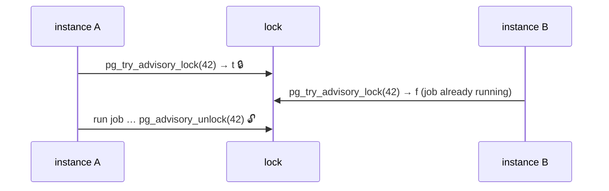

```sql
-- instance A
SELECT pg_try_advisory_lock(42) AS a_got_it;        -- t
-- … run the job …
SELECT pg_advisory_unlock(42) AS a_released;        -- t

-- instance B (while A holds it)
SELECT pg_try_advisory_lock(42) AS b_got_it;        -- f → skip
SELECT locktype, objid, mode, granted FROM pg_locks WHERE locktype = 'advisory';
--  locktype | objid |     mode      | granted
--  advisory |    42 | ExclusiveLock | t
```

| Function | Waits? | Released at |
|---|---|---|
| `pg_advisory_lock(n)` | ✅ waits | `pg_advisory_unlock(n)` or disconnect |
| `pg_try_advisory_lock(n)` | ❌ returns `t` / `f` | `pg_advisory_unlock(n)` or disconnect |
| `pg_advisory_xact_lock(n)` | ✅ waits | end of the **transaction** (automatic) |
| `pg_try_advisory_xact_lock(n)` | ❌ returns `t` / `f` | end of the transaction |

Transaction-level version, released automatically (measured):
```sql
BEGIN;
SELECT pg_advisory_xact_lock(7);
SELECT count(*) FROM pg_locks WHERE locktype = 'advisory' AND objid = 7;   -- 1
COMMIT;
SELECT count(*) FROM pg_locks WHERE locktype = 'advisory' AND objid = 7;   -- 0
```

⚠️ With PgBouncer in transaction mode, use the `_xact_` versions: a session lock would stay on a server connection that another client gets next ([08-04](../08-ops-scaling/04-pgbouncer.md)).

---

# Part 6 — Who blocks whom

## 6.1 Find the blocker

```sql
SELECT pid, application_name AS who, state, pg_blocking_pids(pid) AS blocked_by,
       wait_event_type, now() - xact_start AS xact_age, left(query, 60) AS query
FROM pg_stat_activity
WHERE cardinality(pg_blocking_pids(pid)) > 0;
```

| Column | Tells you |
|---|---|
| `blocked_by` | PIDs holding the lock you wait for |
| `wait_event_type = Lock` | waiting on a lock (not on disk / CPU) |
| `xact_age` | how long the transaction has been open |

Real output while T2 waited for T1's `UPDATE` on row 1:
```text
 who |  pid  | blocked_by | wait_event_type |  wait_event   | state  |                       query
-----+-------+------------+-----------------+---------------+--------+----------------------------------------------------
 T2  | 12267 | {12268}    | Lock            | transactionid | active | UPDATE acc SET balance = balance + 1 WHERE id = 1;
```

## 6.2 The usual culprit: `idle in transaction`

**Definition:** a session that ran `BEGIN` + some statements and then stopped sending commands, without `COMMIT`. It does nothing, but **keeps all its locks**. Typical cause: the app opened a transaction and then waited for an HTTP call, or crashed halfway.

**Example (measured):** T1 updated row 1 and went idle. T2 waits. An admin finds T1 and ends it.

| Step | T1 | T2 | Admin (T3) |
|---|---|---|---|
| 1 | `BEGIN` · `UPDATE … id = 1` 🔒 → idle | | |
| 2 | | `UPDATE … id = 1` → ⏳ | |
| 3 | | | finds the blocker (below) |
| 4 | | | `pg_terminate_backend(15183)` → t |
| 5 | connection closed, transaction rolled back 🔓 | `UPDATE 1` → `1001`, waited **1,155 ms** | |

```sql
-- T3: who is involved?
SELECT pid, application_name AS who, state, pg_blocking_pids(pid) AS blocked_by,
       round(extract(epoch FROM now() - xact_start)::numeric, 1) AS xact_seconds
FROM pg_stat_activity WHERE application_name IN ('T1', 'T2') ORDER BY who;
--   pid  | who |        state        | blocked_by | xact_seconds
--  15183 | T1  | idle in transaction | {}         |          1.6     ← the root blocker
--  15190 | T2  | active              | {15183}    |          1.0

SELECT pg_terminate_backend(15183);      -- t
```

What T1 sees on its next command:
```text
FATAL:  terminating connection due to administrator command
server closed the connection unexpectedly
```

| Function | Effect on the target | Use when |
|---|---|---|
| `pg_cancel_backend(pid)` | cancels the **running statement**, session stays | a long query is running |
| `pg_terminate_backend(pid)` | closes the **connection**, its transaction rolls back | `idle in transaction` (there's no statement to cancel) |

Prevent it instead of fixing it by hand:
```sql
ALTER SYSTEM SET idle_in_transaction_session_timeout = '5min';
SELECT pg_reload_conf();
```

## Key Points
- A lock lasts until `COMMIT` / `ROLLBACK`, not until the statement ends (0.18 ms statement, 2 s lock)
- Waiting = `state = active` + `wait_event_type = Lock`; by default forever
- Readers never wait (MVCC); writers on the **same row** queue
- `FOR UPDATE OF alias` locks one table of a join; `FOR NO KEY UPDATE` + FK checks don't conflict
- Deadlock = waiting cycle → one transaction cancelled after 1 s (`40P01`); fix: lock in a fixed order
- 8 table lock modes: `SELECT` blocks almost nothing, `CREATE INDEX` blocks writes, `ALTER` blocks everything
- `LOCK TABLE … IN EXCLUSIVE MODE` = one writer at a time, readers still allowed (gapless invoice numbers)
- A **waiting** `ALTER` blocks everyone behind it → `SET lock_timeout` before migrations
- `lock_timeout` cancels lock waits only; `statement_timeout` cancels anything slow
- `SKIP LOCKED` = parallel job workers · advisory locks = "only one instance runs this"
- `idle in transaction` keeps its locks → `pg_terminate_backend`, and set `idle_in_transaction_session_timeout`

Lab → [labs/06-transactions-mvcc.sql](../../labs/06-transactions-mvcc.sql)

Next → [05-optimistic-pessimistic](05-optimistic-pessimistic.md)
