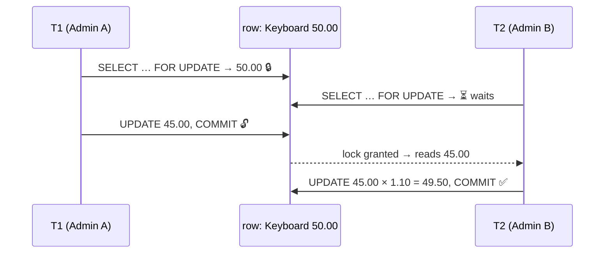
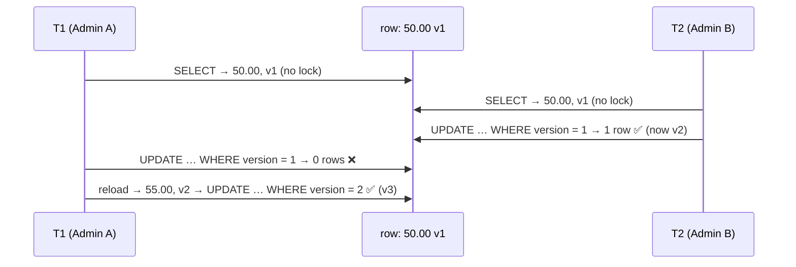
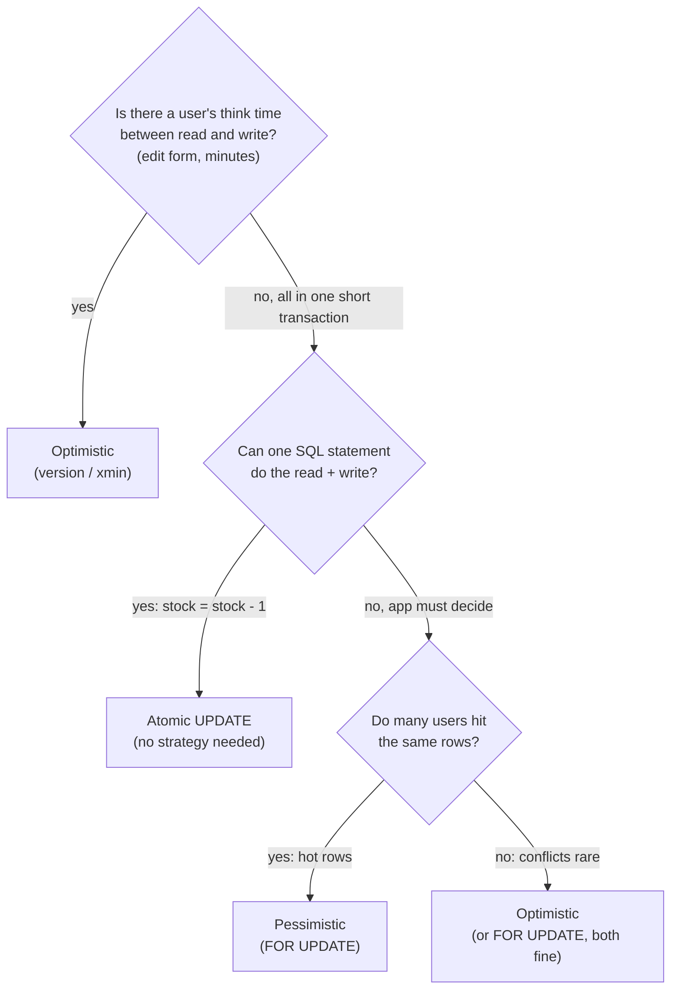

# Pessimistic vs Optimistic Concurrency

> **Definition:** two strategies to stop two users from overwriting each other's changes ([lost update](02-isolation-levels.md#4-lost-update)):
> - **Pessimistic** = "a conflict **will** happen" → **lock** the row first, so others **wait**, then change it.
> - **Optimistic** = "a conflict **probably won't** happen" → **don't lock**. When saving, **check** that nobody changed the row since you read it. If someone did, **reject and retry**.

| Analogy | Pessimistic | Optimistic |
|---|---|---|
| Bathroom | lock the door, others wait outside | — |
| Wikipedia | — | edit freely; on save: "this page changed while you were editing" |

| Part | Contents |
|---|---|
| [Part 1 — Pessimistic](#part-1--pessimistic-locking) | `SELECT … FOR UPDATE` · SQL · C# |
| [Part 2 — Optimistic](#part-2--optimistic-concurrency) | version column · `xmin` · SQL · C# · EF Core |
| [Part 3 — How to choose](#part-3--how-to-choose) | measured benchmark · decision flowchart · scenarios |

## Setup

Two terminals: `docker compose exec pg psql -U app -d shop`, **T1** and **T2**.

```sql
CREATE TABLE items_ol (
    id      int PRIMARY KEY,
    name    text,
    price   numeric(10,2),
    version int NOT NULL DEFAULT 1        -- used by the optimistic approach
);
INSERT INTO items_ol VALUES (1, 'Keyboard', 50.00, 1);
```

**Scenario for both parts:** two admins edit the Keyboard's price at the same time.
- Admin A sets it to **45.00**.
- Admin B raises the current price by **10%**.

All outputs below are real: SQL from two concurrent psql sessions, C# from a console app running two tasks at once, on PostgreSQL 17.

---

# Part 1 — Pessimistic locking

**Definition:** read the row **with a lock** (`SELECT … FOR UPDATE`). Until you `COMMIT`, any other transaction that wants to lock or change that row **waits**. When it finally reads, it sees your committed change.

## Example (measured)

| Step | T1 (Admin A) | T2 (Admin B) | Measured |
|---|---|---|---|
| 1 | `SELECT … FOR UPDATE` → 50.00 🔒 | | |
| 2 | (thinks for 1.5 s, lock held) | `SELECT … FOR UPDATE` → ⏳ waits | |
| 3 | `UPDATE price = 45.00` · `COMMIT` 🔓 | | |
| 4 | | gets the row: **45.00** (not 50.00) → +10% → **49.50** · `COMMIT` | waited **1,198 ms** |

Final: **49.50**. Both changes count: A's 45.00 and then B's +10%. Nothing lost ✅.



## SQL

```sql
-- T1
BEGIN;
SELECT price, version FROM items_ol WHERE id = 1 FOR UPDATE;   -- 50.00 🔒

-- T2
BEGIN;
SELECT price, version FROM items_ol WHERE id = 1 FOR UPDATE;   -- ⏳ hangs

-- T1
UPDATE items_ol SET price = 45.00 WHERE id = 1;
COMMIT;                                                        -- T2 wakes up: 45.00

-- T2
UPDATE items_ol SET price = price * 1.10 WHERE id = 1 RETURNING price;   -- 49.50
COMMIT;
```

## C# (Npgsql)

```csharp
async Task Pessimistic(string who, decimal newPrice, int thinkMs)
{
    await using var conn = await db.OpenConnectionAsync();
    await using var tx = await conn.BeginTransactionAsync();

    await using (var read = new NpgsqlCommand(
        "SELECT price FROM items_ol WHERE id = 1 FOR UPDATE", conn, tx))      // 🔒
    {
        var price = (decimal)(await read.ExecuteScalarAsync())!;
        Console.WriteLine($"[pessimistic] {who} locked row, price = {price}");
    }

    await Task.Delay(thinkMs);                                // app logic while holding the lock

    await using (var write = new NpgsqlCommand(
        "UPDATE items_ol SET price = $1, version = version + 1 WHERE id = 1", conn, tx))
    {
        write.Parameters.Add(new NpgsqlParameter { Value = newPrice });
        await write.ExecuteNonQueryAsync();
    }
    await tx.CommitAsync();                                   // 🔓
}
```

Output (A thinks 1 s, B starts 200 ms later):
```text
[pessimistic] A locked row, price = 50.00 (waited 50 ms)
[pessimistic] A saved 45.00
[pessimistic] B locked row, price = 45.00 (waited 866 ms)    ← B saw A's change
[pessimistic] B saved 55.00
```

## Costs

| Cost | Why | Mitigation |
|---|---|---|
| others **wait** | the lock is held during your whole transaction (1.2 s above) | keep the transaction short: no HTTP calls, no user input inside |
| **deadlocks** | two transactions lock rows in opposite orders | lock in a fixed order ([locks §2.2](04-locks-deadlocks.md#22-fix-always-lock-in-the-same-order)) |
| waits can pile up | a slow holder blocks everyone behind it | `NOWAIT` or `lock_timeout` ([locks part 4](04-locks-deadlocks.md#part-4--waiting-strategies)) |
| **can't span user think time** | an admin keeps an edit form open for 5 minutes → a lock held 5 minutes | use optimistic for that ↓ |

---

# Part 2 — Optimistic concurrency

**Definition:** no lock while reading or thinking. Keep a **version** number in the row. When saving, update **only if the version is still the one you read**, and bump it. `UPDATE 0` = someone saved first → reload and retry (or tell the user).

```sql
UPDATE items_ol
SET price = 45.00, version = version + 1
WHERE id = 1 AND version = 1;     -- 1 = the version I read
-- UPDATE 1 → saved
-- UPDATE 0 → someone changed it since I read it
```

## Example (measured)

| Step | T1 (Admin A) | T2 (Admin B) | Row in DB |
|---|---|---|---|
| 1 | reads: 50.00, **v1** | | 50.00 v1 |
| 2 | (thinks 1.5 s, **no lock**) | reads: 50.00, **v1** | |
| 3 | | `UPDATE … SET 55.00, v2 WHERE version = 1` → **`UPDATE 1`** in **6 ms** (no waiting) | 55.00 v2 |
| 4 | `UPDATE … SET 45.00, v2 WHERE version = 1` → **`UPDATE 0`** ❌ | | 55.00 v2 |
| 5 | reload: 55.00, **v2** → decide again → `… WHERE version = 2` → `UPDATE 1` ✅ | | 45.00 v3 |



## SQL: version column

```sql
-- T1
SELECT price, version FROM items_ol WHERE id = 1;     -- 50.00 | 1

-- T2
SELECT price, version FROM items_ol WHERE id = 1;     -- 50.00 | 1
UPDATE items_ol SET price = 55.00, version = version + 1
WHERE id = 1 AND version = 1;                         -- UPDATE 1 (6 ms, no wait)

-- T1
UPDATE items_ol SET price = 45.00, version = version + 1
WHERE id = 1 AND version = 1;                         -- UPDATE 0 ❌ stale

SELECT price, version FROM items_ol WHERE id = 1;     -- 55.00 | 2   ← reload
UPDATE items_ol SET price = 45.00, version = version + 1
WHERE id = 1 AND version = 2
RETURNING price, version;                             -- 45.00 | 3 ✅
```

## SQL: `xmin` instead of a version column

**Definition:** `xmin` is a hidden system column on every row: the ID of the transaction that wrote this row version ([MVCC](03-mvcc.md)). Every `UPDATE` changes it, so it works as a free version number.

```sql
SELECT xmin, price FROM items_ol WHERE id = 1;            -- 51587 | 50.00   (remember 51587)

-- someone else:
UPDATE items_ol SET price = 55.00 WHERE id = 1 RETURNING xmin;   -- xmin is now 51588

-- my save, checking the xmin I read:
UPDATE items_ol SET price = 45.00 WHERE id = 1 AND xmin = '51587';
-- UPDATE 0 ❌ stale
```

| | `version` column | `xmin` |
|---|---|---|
| Schema change | add a column | none |
| Changes when | your code bumps it | any update of the row (even by triggers, admin scripts) |
| Survives `pg_dump` / restore | ✅ | ❌ new values after restore (fine: no edits span a restore) |
| Portable to other databases | ✅ | PostgreSQL only |

## C# (Npgsql): version check + retry

```csharp
async Task Optimistic(string who, decimal delta, int thinkMs)
{
    for (var attempt = 1; attempt <= 3; attempt++)
    {
        decimal price; int version;
        await using (var read = db.CreateCommand("SELECT price, version FROM items_ol WHERE id = 1"))
        await using (var r = await read.ExecuteReaderAsync())
        {
            await r.ReadAsync();
            price = r.GetDecimal(0); version = r.GetInt32(1);
        }

        await Task.Delay(thinkMs);                               // app logic, no lock held

        await using var write = db.CreateCommand(
            "UPDATE items_ol SET price = $1, version = version + 1 WHERE id = 1 AND version = $2");
        write.Parameters.Add(new NpgsqlParameter { Value = price + delta });
        write.Parameters.Add(new NpgsqlParameter { Value = version });

        if (await write.ExecuteNonQueryAsync() == 1) return;     // saved
        // 0 rows → someone saved first → loop: reload and try again
    }
    throw new InvalidOperationException("too many conflicts");
}
```

Output (A: −5, thinks 1 s · B: +5, starts 200 ms later):
```text
[optimistic]  B attempt 1: read v1 price 50.00 → saved 55.00
[optimistic]  A attempt 1: read v1 → 0 rows updated (someone changed it) → retry
[optimistic]  A attempt 2: read v2 price 55.00 → saved 50.00
final: 50.00 v3        ← 50 + 5 − 5: both changes applied
```

## C# (EF Core): built in with `xmin`

Mark a property as the row version, and EF Core adds the check to every `UPDATE` (from [samples/dotnet/03-EfCore](../../samples/dotnet/03-EfCore/ShopContext.cs)):

```csharp
public uint Version { get; set; }                               // entity property
p.Property(x => x.Version).IsRowVersion();                      // maps to the system column xmin
```

```csharp
var a = await first.Products.SingleAsync(p => p.Id == 1);       // context 1 reads
var b = await second.Products.SingleAsync(p => p.Id == 1);      // context 2 reads the same row

a.Stock += 1;
await first.SaveChangesAsync();                                 // ✅ xmin changes

b.Stock += 1;
try { await second.SaveChangesAsync(); }                        // ❌ xmin is stale
catch (DbUpdateConcurrencyException) { /* reload, merge or ask the user */ }
```

SQL that EF Core sent (real log from `dotnet run --project 03-EfCore`):
```text
SELECT p.id, p.category, p.name, p.price, p.stock, p.xmin, p.attrs
FROM products AS p WHERE p.id = 1 LIMIT 2

UPDATE products SET stock = @p0 WHERE id = @p1 AND xmin = @p2 RETURNING xmin;
  -- first:  @p2='51206' → 1 row
  -- second: @p2='51206' → 0 rows → DbUpdateConcurrencyException

== concurrency
second save rejected: row changed since it was read
```

## Optimistic inside the database too

[Repeatable Read and Serializable](02-isolation-levels.md#part-2--the-4-levels) are optimistic as well: no locks for reading, and a `40001` error when a conflict is detected → retry. A version column does the same thing in your own code, at Read Committed, and across several requests (the user's edit form).

---

# Part 3 — How to choose

## Measured: 20 clients, read → 5 ms of app work → write

pgbench, 10 s per run. "Successful writes" = rows really updated (optimistic `UPDATE 0`s don't count).

| Contention | Strategy | Attempts | Successful writes | Success rate | Latency |
|---|---|---|---|---|---|
| **High**: everyone edits the **same 1 row** | pessimistic | 1,206 | **1,206** | 100% | 168 ms (queueing) |
| | optimistic | 10,079 | **648** | **6%** | 20 ms, but 94% rejected |
| **Low**: random row out of 10,000 | pessimistic | 23,999 | 23,999 | 100% | 8.3 ms |
| | optimistic | 24,621 | **24,583** | 99.8% | **8.1 ms** |

What the numbers say:
- **Hot row** → optimistic wastes 94% of its work on conflicts (648 useful writes vs 1,206) → **pessimistic wins**.
- **Spread out** → conflicts are rare (0.2%), no lock waits → optimistic is equal or slightly faster.



## Side by side

| | Pessimistic | Optimistic |
|---|---|---|
| Assumes | conflicts are common | conflicts are rare |
| Mechanism | `SELECT … FOR UPDATE` lock | `WHERE version = :v` check |
| On conflict | the second one **waits** | the second one gets **`UPDATE 0`** → retry or ask the user |
| Lock held | for the whole transaction | never |
| Works across HTTP requests / user think time | ❌ | ✅ |
| Deadlocks possible | ✅ (fix: lock order) | ❌ |
| Wasted work under heavy contention | ❌ none | ✅ many retries (94% in the test) |
| Needs | short transactions | a version (or `xmin`) + retry/merge logic |

## Real-world scenarios

| Scenario | Pick | Why |
|---|---|---|
| Admin edits a product form for minutes | **Optimistic** | can't hold a lock while a human types; conflicts are rare |
| Two users edit the same document / wiki page | **Optimistic** | show "changed while you were editing" and let the user merge |
| Checkout: decrease stock by 1 | **Atomic UPDATE** `SET stock = stock - 1 WHERE stock > 0` | one statement, no read-then-write in the app |
| Flash sale: 1,000 buyers, 10 items | **Pessimistic** or atomic | hot rows: optimistic would mostly fail |
| Bank transfer between two accounts | **Pessimistic** in id order | must succeed, short transaction |
| Seat / room booking | **Pessimistic**, or a constraint (`EXCLUDE`) | hot rows at opening time |
| Job queue with many workers | **Pessimistic** + `SKIP LOCKED` | workers skip each other's jobs ([locks §4.3](04-locks-deadlocks.md#43-skip-locked-job-queue)) |
| REST API `PUT` with `If-Match: <version>` header | **Optimistic** | the version travels to the client and back (HTTP 412 on conflict) |

## Key Points
- **Pessimistic** = lock first (`FOR UPDATE`), others wait: no lost work, but waits and deadlock risk
- **Optimistic** = check on save (`WHERE version = :v`), `UPDATE 0` → retry: no waits, but wasted work when conflicts are frequent
- Measured: hot row → pessimistic 1,206 writes vs optimistic 648 (94% rejected); spread rows → both ~equal
- User think time / across requests → optimistic (version column or `xmin`, EF Core `IsRowVersion()`)
- Simple arithmetic → neither: atomic `UPDATE … SET x = x - 1`

Next → [07-internals/01-storage-pages](../07-internals/01-storage-pages.md)
